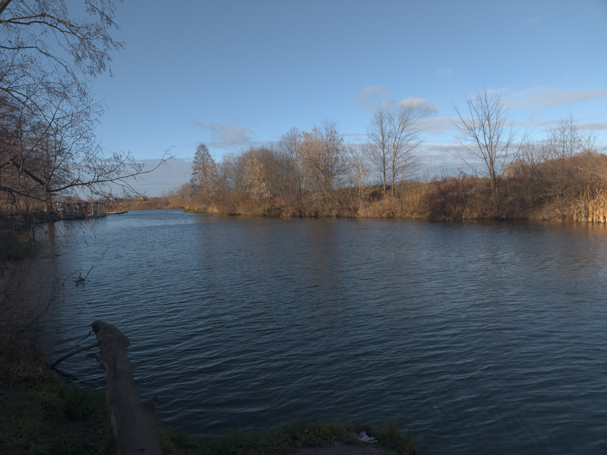
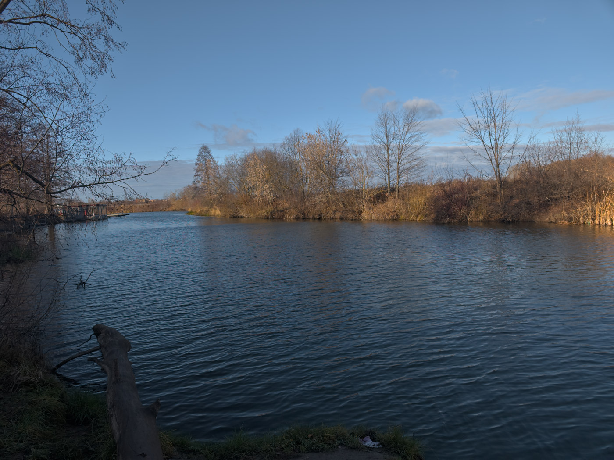
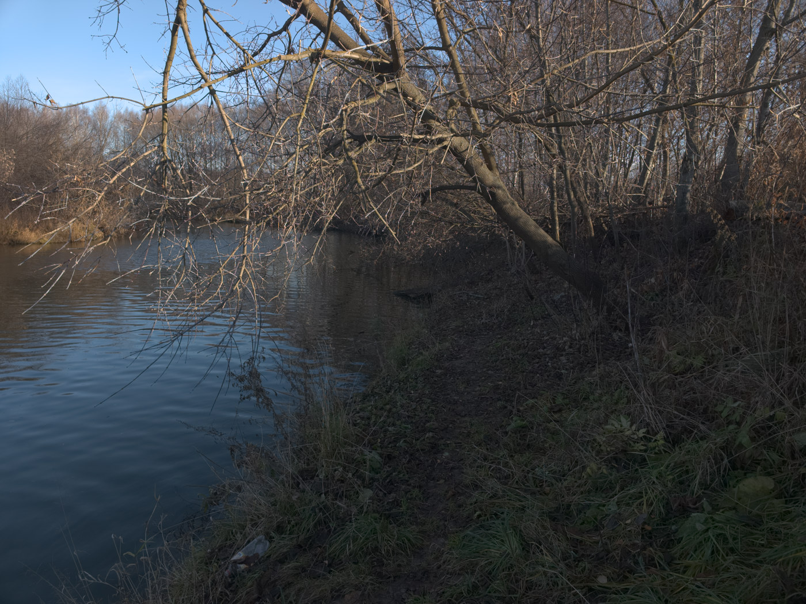
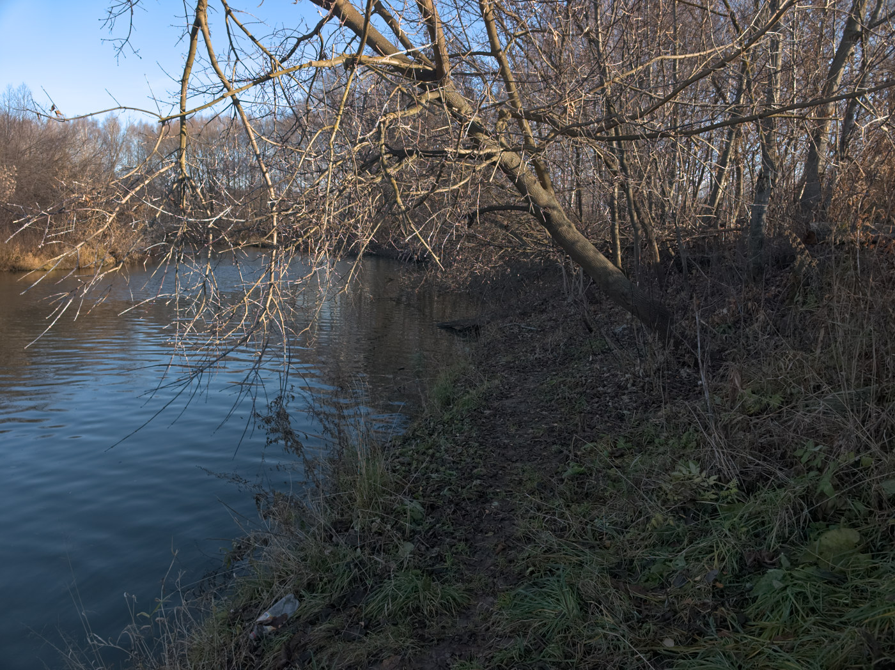
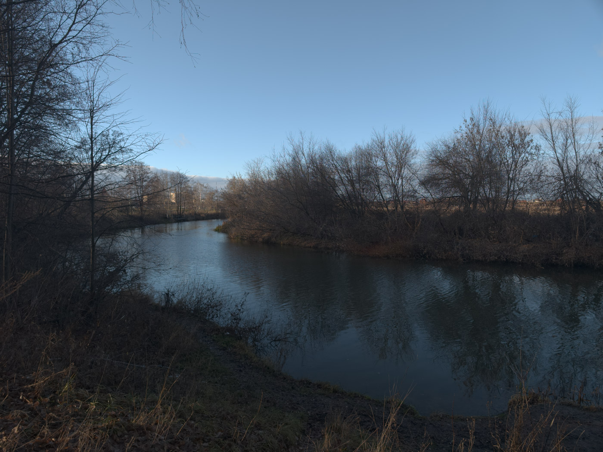
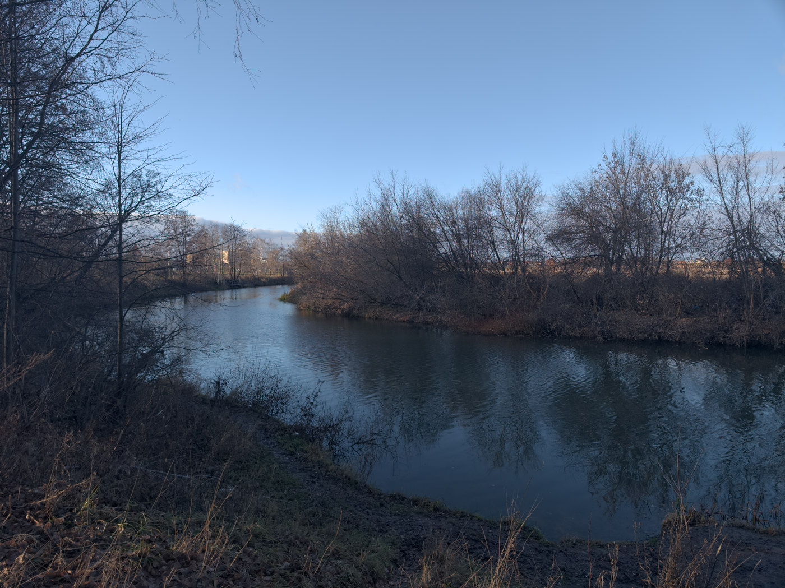
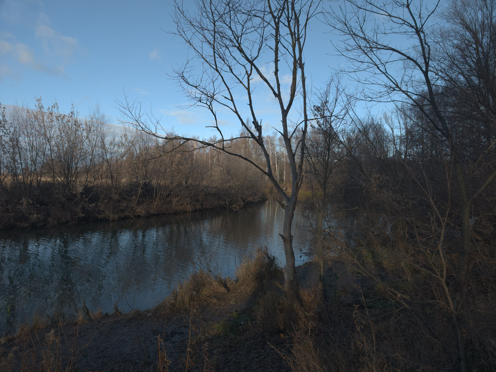
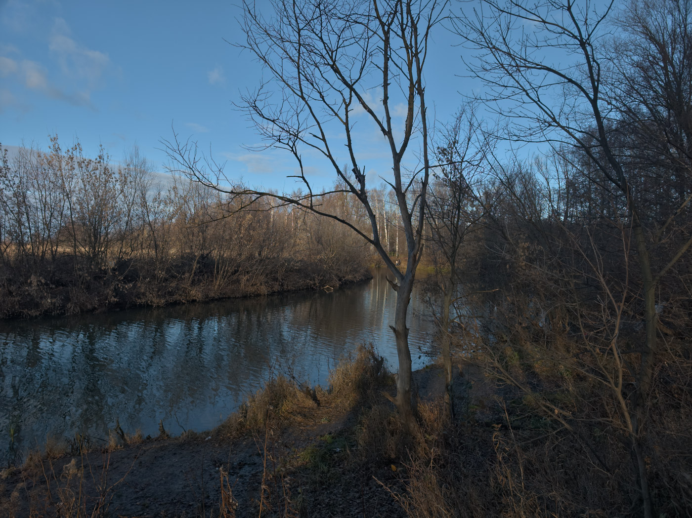

# LightCraft Manual Editing Skill

> An AI agent skill for **automatic photo improvement of RAW files** in **LightCraft 0.21.1**. The agent enhances photos by setting every slider explicitly — real mask geometry, real pointer gestures, no one-click `Auto` button. Non-destructive RAW editing, HDR, masks, presets and export, end to end.

🌐 **Live site:** https://ildargiv.github.io/lightcraft-manual-skill/  
📄 Translations: [Русский](translations/README.ru.md) · [简体中文](translations/README.zh-CN.md) · [Español](translations/README.es.md) · [Français](translations/README.fr.md) · [Deutsch](translations/README.de.md) · [日本語](translations/README.ja.md) · [Português (BR)](translations/README.pt-BR.md) · [한국어](translations/README.ko.md)

Languages: **English** · [Русский](translations/README.ru.md) · [简体中文](translations/README.zh-CN.md) · [Español](translations/README.es.md) · [Français](translations/README.fr.md) · [Deutsch](translations/README.de.md) · [日本語](translations/README.ja.md) · [Português (BR)](translations/README.pt-BR.md) · [한국어](translations/README.ko.md)

---

## What it is

LightCraft is an open-source, non-destructive RAW developer (a Lightroom alternative) with a built-in MCP server. This repository is a drop-in **OpenCode / Claude Code / Codex skill**:

```
~/.config/opencode/skills/lightcraft/
├── SKILL.md                  # doctrine, workflow, tool routing, traps
├── references/               # 12 on-demand manuals (see below)
└── scripts/                  # MCP launcher, app launcher, reference refresher, addon inventory
```

It covers all **392** LightCraft commands, **114** develop sliders, the complete `develop` JSON schema, every mask family, spot removal, Point Color, HDR, bracket merging, export, and the **41 built-in presets together with their actual numeric recipes**.

## Install

```bash
git clone https://github.com/ildargiv/lightcraft-manual-skill.git \
  ~/.config/opencode/skills/lightcraft
```

Restart your agent so it rescans skills. Requirements: LightCraft 0.21.1+, Python 3 (only for the helper scripts).

### Live app connection (recommended)

The MCP server is registered in `opencode.json` through a self-healing wrapper:

```json
"lightcraft": {
  "type": "local",
  "command": ["python", "<skills>/lightcraft/scripts/mcp-connect.py"],
  "enabled": true
}
```

`mcp-connect.py` starts the desktop app with `--control 7980` if needed, then hands stdio to `lightcraft-cli mcp --compact --connect 127.0.0.1:7980`. The agent gets all editing tools **plus** live UI tools: `screenshot`, `click`, `press_key`, `pointer_gesture`, `set_ui`, `clipboard`.

Manual equivalent:

```powershell
powershell -ExecutionPolicy Bypass -File <skills>/lightcraft/scripts/start-lightcraft-app.ps1
```

## Our advantages

1. **Manual editing is a rule, not a wish.** Explicitly forbids `develop.auto`, `develop.autoBwMix`, Auto WB, `crop.autoStraighten`, `geometry.upright auto`, `spot.findDust` / `findBlemishes`, `lensBlur.findSubject`, `preset.apply`, `develop.sync` / `autoSync`, `develop.matchExposure`. Every prohibition comes with a manual replacement — explicit numbers and coordinates.

2. **Full coverage of the application.** 392 commands with parameter docs, 114 sliders with ranges/steps/defaults, the complete `develop` JSON schema, all 10 mask families, brushes, components, spots, red eye, Point Color, Lens Blur, curves, HSL, colour grading, optics, geometry, print, slideshow, archive.

3. **Every preset decompiled to numbers.** For each of the 41 built-in presets the actual content is exported: which fields it sets and to what values. The agent can **reproduce the look by hand** and tune it for the frame instead of pressing a button. Plus 3 point-curve and 8 export presets.

4. **HDR end to end.** `develop.hdr` + `maxEv` + `hdr.sdr*`, bracket merges (`merge.hdr`, `hdrBatch`, panorama), gain-map JPEG export (ISO 21496-1), 10-bit PQ/HLG AVIF, 16-bit Rec.2020 PQ PNG/JXL, 32-bit float TIFF. Verified with ffprobe: `rgb48be`, `smpte2084`, `bt2020`. Previews are always SDR — the agent does not “fix” invisible HDR with exposure.

5. **Live UI and real gestures.** Connect mode provides `screenshot`, `click`, `pointer_gesture`, `press_key`. The agent sees the result in the LightCraft window and can draw a brush or gradient with a real gesture in normalised image coordinates, not only through commands.

6. **Self-healing MCP.** The wrapper starts the app with the control port and removes the `catalog.lock` conflict (a headless server and the desktop app cannot hold the same library).

7. **Self-updating documentation.** `scripts/refresh-reference.py` regenerates the command/slider catalogues and all preset recipes from the installed version, and checks it against the latest GitHub release.

8. **Add-on awareness and safe importing.** Supported formats (`.lcpreset`, XMP, `.lrtemplate`, `.cube`, `.dcp`, `.lceffect`, `.lccurve`, SAM 3, denoise ONNX), `dryRun` import workflow, a critical review of third-party projects, and a warning about pirated bundles.

9. **Verified on real RAW files.** The examples below are Xiaomi 13 Ultra DNGs developed by hand; each comes with the exact `develop` JSON needed to reproduce it.

10. **Guardrails.** Experiments on `photo.virtualCopy` only, test exports to temp, refusal to overwrite originals/XMP, untrusted metadata handling, `history.list` / `restore` and `edit.undo` on every step.

## Contents

| File | What's inside |
|---|---|
| `SKILL.md` | Manual-only doctrine, edit pipeline, tool routing, UI section, traps |
| `references/controls.md` | Every slider: id, min, max, default, step |
| `references/develop-json.md` | Full develop settings schema with field semantics |
| `references/masks-spots.md` | All mask shapes, brushes, components, spots, red eye, Point Color, Lens Blur |
| `references/hdr.md` | HDR editing, SDR rendition, merge, export, verification |
| `references/presets.md` | 41 presets with exact values, curve presets, export presets |
| `references/manual-editing.md` | 12 genre recipes with concrete numbers |
| `references/export.md` | Formats, sizes, metadata, watermark, contact sheet |
| `references/commands-edit.md` | Editing commands with full parameter docs |
| `references/commands-rest.md` | Library, metadata, print, slideshow, faces |
| `references/library.md` | Non-editing capabilities map |
| `references/addons.md` | Add-ons, models, community projects |
| `scripts/*` | MCP launcher, app launcher, reference refresher, addon inventory |

## Examples

Seven Xiaomi 13 Ultra DNGs from one shoot (river near the port), developed by hand. Every JPEG was produced with `lightcraft-cli render` from the corresponding `original.dng` and the exact settings JSON — no `develop.auto`, no `preset.apply`, no automatic straightening or subject detection.

### 01 — HDR river, sky gradient + local tree mask


- [original.dng](examples/01-river-hdr/original.dng) · [manual settings](examples/settings/01-river-hdr.json) · [HDR gain-map JPEG](examples/01-river-hdr/after-hdr-gainmap.jpg)
- Headroom 3.5 EV, SDR rendition tuned separately, `linear` sky mask + `radial` tree mask.

### 02 — Blue hour, manual WB and split grading


- [original.dng](examples/02-blue-hour/original.dng) · [manual settings](examples/settings/02-blue-hour.json)
- WB 4200 K / +6 tint set by hand, blue shadows against warm highlights, NR 20/28.

### 03 — Golden hour, warm local mask


- [original.dng](examples/03-golden-river/original.dng) · [manual settings](examples/settings/03-golden-river.json)
- Highlights −50, shadows +35, orange/yellow mixer, soft radial foliage mask.

### 04 — Wide river, blue sky and golden reeds





- [original.dng](examples/04-river-wide/original.dng) · [manual settings](examples/settings/04-river-wide.json)

### 05 — Dark bank, shadow recovery without an AI denoiser





- [original.dng](examples/05-dark-bank/original.dng) · [manual settings](examples/settings/05-dark-bank.json)

### 06 — Reflections, manual white balance and cool shadows





- [original.dng](examples/06-reflection/original.dng) · [manual settings](examples/settings/06-reflection.json)

### 07 — River and sky, a second HDR grade





- [original.dng](examples/07-river-sky-hdr/original.dng) · [manual settings](examples/settings/07-river-sky-hdr.json)

All exports use `metadata=none`, 1400 px long edge, JPEG quality 88. The HDR examples additionally write an ISO 21496-1 gain map (`hdrgm` marker verified).

## Verify it yourself

```powershell
python scripts/addon-inventory.py
python scripts/refresh-reference.py
```

```bash
lightcraft-cli render examples/01-river-hdr/original.dng -o repro.jpg \
  --settings examples/settings/01-river-hdr.json --size 1400 \
  --opt metadata=none --opt quality=88 --opt hdr=true
```

## Limitations

- LightCraft is alpha (0.21.1); there is no official plug-in API yet — “add-ons” are imported presets/profiles/models plus external utilities.
- SAM 3 is not bundled (≈3.4 GB, Meta licence); Object/Describe masks need it. Sky/Subject/Background work without.
- LightCraft cannot display HDR on screen: previews are SDR. Judge HDR by the exported gain map / PQ file.
- Third-party repositories in `addons.md` are unofficial and unverified; review code and licences before use.

## License

MIT — see [LICENSE](LICENSE). The skill text and scripts are original work. LightCraft itself is a separate project by the ArtCraft team (MIT OR Apache-2.0). Example DNGs remain the property of their author and are included for demonstration only.

## Find this project

automatic photo improvement · AI photo enhancer · RAW file editor · RAW photo editing software · HDR photo editing · Lightroom alternative for RAW files · non-destructive RAW workflow · MCP photo editing agent · photo retouching automation · Xiaomi 13 Ultra RAW · improve JPEG and RAW photos

---

Made for an agent that can press buttons but prefers to work by hand.
