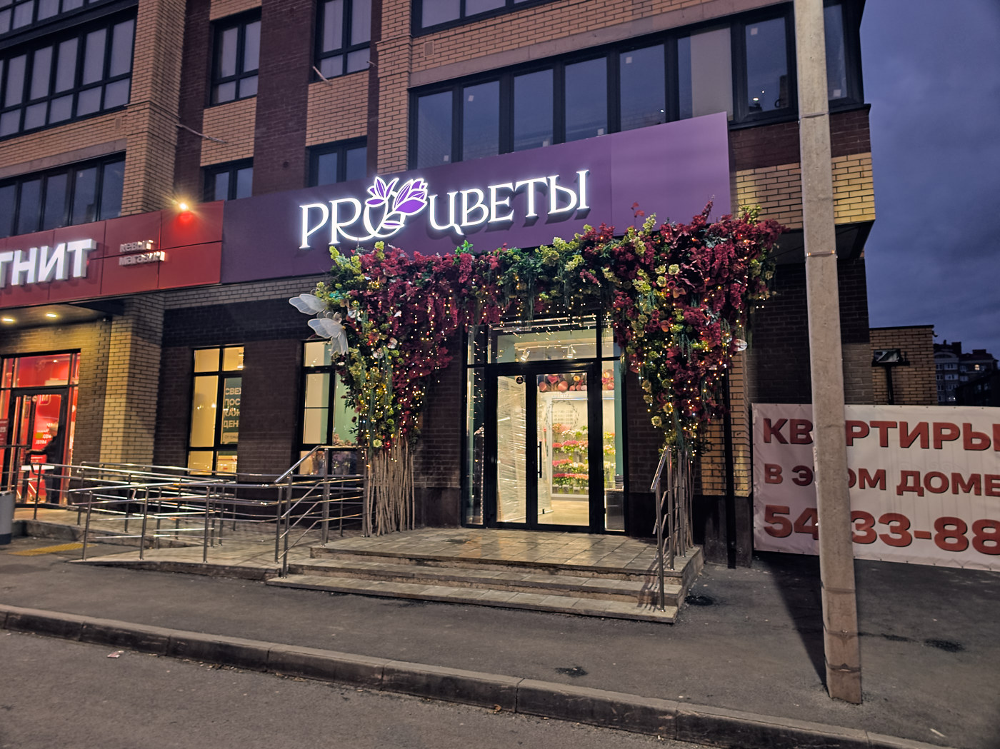
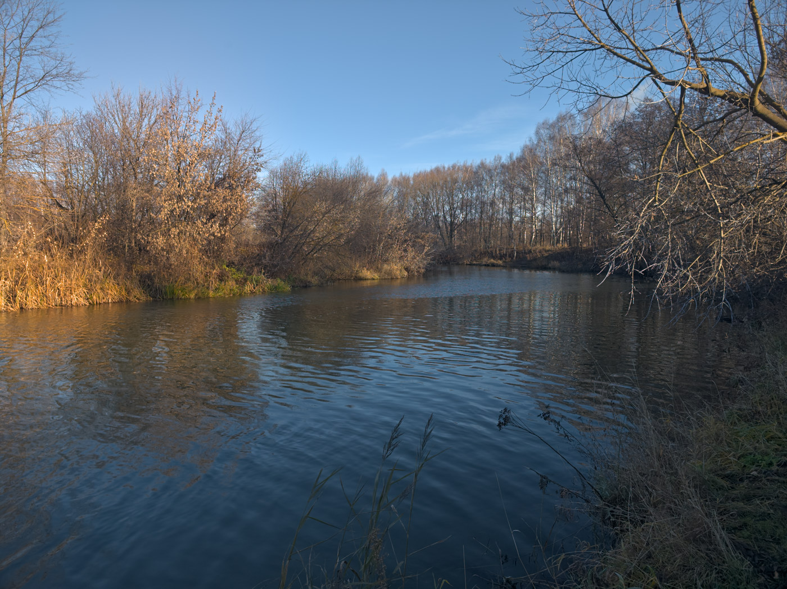

# LightCraft Manual Editing Skill

> An agent skill that teaches an AI agent to edit photos in **LightCraft 0.21.1** entirely **by hand** — explicit slider values, real mask geometry, real pointer gestures. No `Auto`, no magic.

Русская версия ниже. Скилл написан на русском, но все идентификаторы команд и полей — английские, так что работает с любым агентом.

---

## What it is

LightCraft is an open-source, non-destructive RAW developer (Lightroom alternative) with a built-in MCP server. This repository is a drop-in **OpenCode / Claude Code / Codex skill**:

```
~/.config/opencode/skills/lightcraft/
├── SKILL.md                  # doctrine, workflow, tool routing, traps
├── references/               # 12 on-demand manuals (see below)
└── scripts/                  # MCP launcher, app launcher, reference refresher, addon inventory
```

It covers all **392** LightCraft commands, **114** develop sliders, the complete `develop` JSON schema, every mask family, spot removal, Point Color, HDR, bracket merging, export, and all **41 built-in presets with their actual numeric recipes**.

## Install

```bash
git clone https://github.com/ildargiv/lightcraft-manual-skill.git \
  ~/.config/opencode/skills/lightcraft
```

Restart your agent so it rescans skills. Requirements: LightCraft 0.21.1+, Python 3 (only for the helper scripts).

### Live app connection (recommended)

The MCP server is registered in `opencode.json` through a self-healing wrapper:

```json
"lightcraft": {
  "type": "local",
  "command": ["python", "<skills>/lightcraft/scripts/mcp-connect.py"],
  "enabled": true
}
```

`mcp-connect.py` starts the desktop app with `--control 7980` if needed, then hands stdio to `lightcraft-cli mcp --compact --connect 127.0.0.1:7980`. The agent gets all editing tools **plus** live UI tools: `screenshot`, `click`, `press_key`, `pointer_gesture`, `set_ui`, `clipboard`.

Manual equivalent:

```powershell
powershell -ExecutionPolicy Bypass -File <skills>/lightcraft/scripts/start-lightcraft-app.ps1
```

---

## Наши достоинства

1. **Ручная правка как правило, а не пожелание.** Прямой запрет на `develop.auto`, `develop.autoBwMix`, Auto WB, `crop.autoStraighten`, `geometry.upright auto`, `spot.findDust/findBlemishes`, `lensBlur.findSubject`, `preset.apply`, `develop.sync/autoSync`, `develop.matchExposure`. Для каждого запрета указана ручная замена — явные числа и координаты.

2. **Полный охват возможностей.** 392 команды с параметрами, 114 слайдеров с диапазонами/шагами/дефолтами, полная схема `develop` JSON, все 10 типов масок, кисти, spots, red eye, Point Color, Lens Blur, градиенты, кривые, HSL, color grading, оптика, геометрия, печать, слайдшоу, архив.

3. **Все пресеты разобраны до чисел.** Для каждого из 41 встроенного пресета выгружено фактическое содержимое: какие поля и какие значения он задаёт. Агент может **воспроизвести look руками** и довести его под кадр, не нажимая кнопку preset. Плюс 3 point-curve и 8 export-пресетов.

4. **HDR от начала до конца.** `develop.hdr` + `maxEv` + `hdr.sdr*`, склейка брекетов (`merge.hdr`, `hdrBatch`, panorama), экспорт gain-map JPEG (ISO 21496-1), 10-bit PQ/HLG AVIF, 16-bit Rec.2020 PQ PNG/JXL, 32-bit float TIFF. Проверено ffprobe: `rgb48be`, `smpte2084`, `bt2020`. Отдельно описано, что превью всегда SDR — агент не «исправляет» невидимый HDR экспозицией.

5. **Живой UI и настоящие жесты.** Connect-режим даёт `screenshot`, `click`, `pointer_gesture`, `press_key`. Агент видит результат в окне LightCraft и может провести кисть/градиент реальным жестом в нормализованных координатах кадра, а не только командами.

6. **Самовосстанавливающийся MCP.** Обёртка поднимает приложение с контрольным портом и убирает конфликт за `catalog.lock` (headless-сервер и десктоп не могут держать одну библиотеку одновременно).

7. **Самообновляемая документация.** `scripts/refresh-reference.py` перегенерирует каталоги команд, слайдеров и рецепты всех пресетов из установленной версии и сверяет её с последним релизом GitHub.

8. **Знание дополнений и безопасный импорт.** Какие форматы поддерживаются (`.lcpreset`, XMP, `.lrtemplate`, `.cube`, `.dcp`, `.lceffect`, `.lccurve`, SAM 3, denoise ONNX), как импортировать с `dryRun`, критический обзор сторонних проектов и предупреждение о пиратских сборках.

9. **Проверено на реальных RAW.** Примеры ниже — Xiaomi 13 Ultra, DNG, обработаны вручную; для каждого сохранён точный `develop` JSON, по которому правку можно повторить.

10. **Предохранители.** Эксперименты только на `photo.virtualCopy`, тестовые экспорты в temp, отказ перезаписывать оригинал/XMP, работа с метаданными как с недоверенными данными, `history.list/restore` и `edit.undo` на каждом шаге.

---

## Contents

| File | What's inside |
|---|---|
| `SKILL.md` | Manual-only doctrine, edit pipeline, tool routing, UI section, traps |
| `references/controls.md` | Every slider: id, min, max, default, step |
| `references/develop-json.md` | Full develop settings schema with field semantics |
| `references/masks-spots.md` | All mask shapes, brushes, components, spots, red eye, Point Color, Lens Blur |
| `references/hdr.md` | HDR editing, SDR rendition, merge, export, verification |
| `references/presets.md` | 41 presets with exact values, curve presets, export presets |
| `references/manual-editing.md` | 12 genre recipes with concrete numbers |
| `references/export.md` | Formats, sizes, metadata, watermark, contact sheet |
| `references/commands-edit.md` | Editing commands with full parameter docs |
| `references/commands-rest.md` | Library, metadata, print, slideshow, faces |
| `references/library.md` | Non-editing capabilities map |
| `references/addons.md` | Add-ons, models, community projects |
| `scripts/*.py`, `scripts/*.ps1` | MCP launcher, app launcher, reference refresher, addon inventory, examples builder |

## Examples

Three real DNGs from one shoot (river near the port, Xiaomi 13 Ultra). Every result was made by setting numbers by hand — no `Auto`, no preset applied. Originals are shipped so you can reproduce the edits with `lightcraft-cli render ... --settings examples/settings/<file>.json`.

### 01 — HDR river, sky gradient + local tree mask


- [original.dng](examples/01-river-hdr/original.dng) · [manual settings](examples/settings/01-river-hdr.json) · [HDR gain-map JPEG](examples/01-river-hdr/after-hdr-gainmap.jpg)
- Headroom 3.5 EV, SDR rendition tuned separately, `linear` sky mask + `radial` tree mask.

### 02 — Blue hour, manual WB and split grading




- [original.dng](examples/02-blue-hour/original.dng) · [manual settings](examples/settings/02-blue-hour.json)
- WB 4200 K / +6 tint set by hand, blue shadows + warm highlights via grading wheels, NR 20/28.

### 03 — Golden hour, warm local mask




- [original.dng](examples/03-golden-river/original.dng) · [manual settings](examples/settings/03-golden-river.json)
- Highlights −50, shadows +35, orange/yellow mixer, soft radial foliage mask.

All exports use `metadata=none`, 1400 px long edge, JPEG quality 88. The HDR example additionally writes an ISO 21496-1 gain map (`hdrgm` marker verified).

## Verify it yourself

```powershell
python scripts/addon-inventory.py
python scripts/refresh-reference.py
```

```bash
lightcraft-cli render examples/01-river-hdr/original.dng -o repro.jpg \
  --settings examples/settings/01-river-hdr.json --size 1400 \
  --opt metadata=none --opt quality=88 --opt hdr=true
```

## Limitations

- LightCraft is alpha (0.21.1); there is no official plug-in API yet — "add-ons" are imported presets/profiles/models plus external utilities.
- SAM 3 is not bundled (≈3.4 GB, Meta licence); Object/Describe masks need it. Sky/Subject/Background work without.
- LightCraft cannot display HDR on screen: previews are SDR. Judge HDR by exported gain map / PQ file.
- Third-party repositories listed in `addons.md` are unofficial and unverified; review code and licences before use.

## License

MIT — see [LICENSE](LICENSE). The skill text and scripts are original work. LightCraft itself is a separate project by the ArtCraft team (MIT OR Apache-2.0). Example DNGs remain the property of their author and are included for demonstration only.

---

Сделано для агента, который умеет нажимать кнопки, но предпочитает думать руками.
