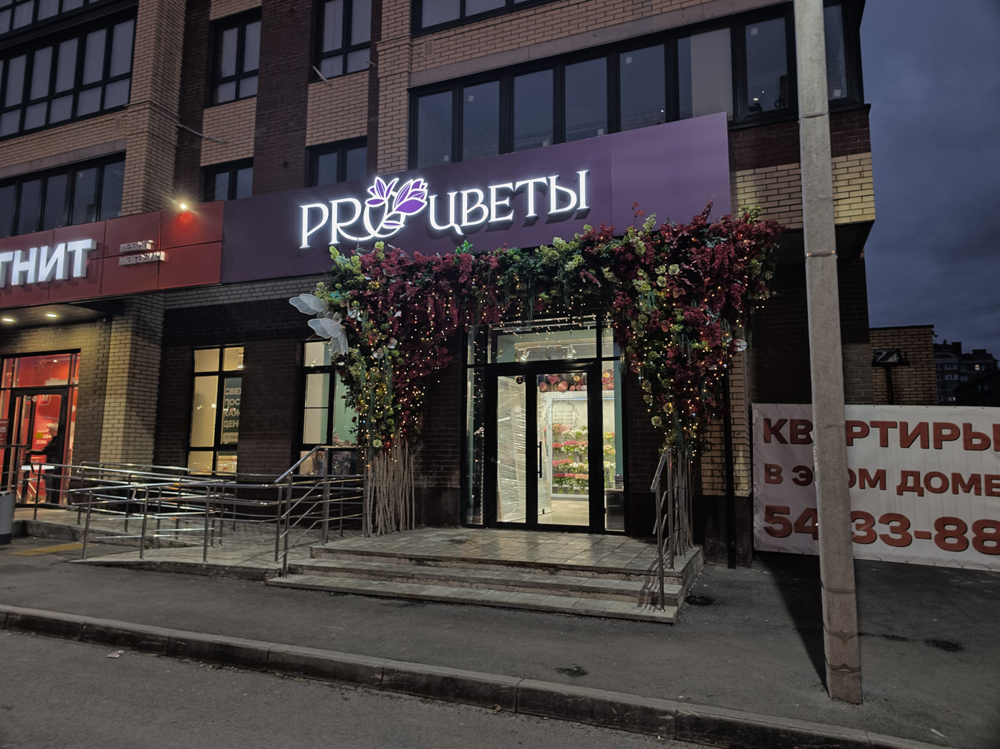

# LightCraft Manual Editing Skill

> Eine Skill, die einem KI-Agenten beibringt, Fotos in **LightCraft 0.21.1** komplett **von Hand** zu bearbeiten: explizite Reglerwerte, echte Maskengeometrie, echte Zeigerbewegungen. Kein `Auto`, keine Magie.

Sprachen: [English](../README.md) · [Русский](README.ru.md) · [简体中文](README.zh-CN.md) · [Español](README.es.md) · [Français](README.fr.md) · **Deutsch** · [日本語](README.ja.md) · [Português (BR)](README.pt-BR.md) · [한국어](README.ko.md)

---

## Was es ist

LightCraft ist ein quelloffener, destruktionsfreier RAW-Entwickler (eine Lightroom-Alternative) mit integriertem MCP-Server. Dieses Repository ist eine sofort einsetzbare **Skill für OpenCode / Claude Code / Codex**:

```
~/.config/opencode/skills/lightcraft/
├── SKILL.md                  # Doktrin, Arbeitsablauf, Werkzeugrouting, Fallen
├── references/               # 12 bei Bedarf lesbare Handbücher
└── scripts/                  # MCP-Starter, App-Starter, Dokumentations-Update, Add-on-Inventar
```

Sie deckt alle **392** Befehle, **114** Entwicklungsregler, das vollständige `develop`-JSON-Schema, alle Maskenfamilien, Punktentfernung, Point Color, HDR, Bracketing-Fusion, Export und die **41 integrierten Presets mit ihren tatsächlichen numerischen Rezepten** ab.

## Installation

```bash
git clone https://github.com/ildargiv/lightcraft-manual-skill.git \
  ~/.config/opencode/skills/lightcraft
```

Starten Sie Ihren Agenten neu, damit er die Skills erneut scannt. Voraussetzungen: LightCraft 0.21.1+ und Python 3 (nur für die Hilfsskripte).

### Verbindung zur laufenden Anwendung (empfohlen)

Der MCP-Server wird in `opencode.json` über einen selbstheilenden Wrapper registriert:

```json
"lightcraft": {
  "type": "local",
  "command": ["python", "<skills>/lightcraft/scripts/mcp-connect.py"],
  "enabled": true
}
```

`mcp-connect.py` startet bei Bedarf die Desktop-Anwendung mit `--control 7980` und übergibt danach stdio an `lightcraft-cli mcp --compact --connect 127.0.0.1:7980`. Der Agent erhält alle Bearbeitungswerkzeuge **zuzüglich** der Live-UI-Werkzeuge: `screenshot`, `click`, `press_key`, `pointer_gesture`, `set_ui`, `clipboard`.

Manuelles Äquivalent:

```powershell
powershell -ExecutionPolicy Bypass -File <skills>/lightcraft/scripts/start-lightcraft-app.ps1
```

## Unsere Vorteile

1. **Manuelles Arbeiten ist Regel, nicht Wunsch.** Ausdrücklich verboten: `develop.auto`, `develop.autoBwMix`, Auto-WB, `crop.autoStraighten`, `geometry.upright auto`, `spot.findDust`/`findBlemishes`, `lensBlur.findSubject`, `preset.apply`, `develop.sync`/`autoSync`, `develop.matchExposure`. Zu jedem Verbot gibt es eine manuelle Alternative — explizite Zahlen und Koordinaten.
2. **Vollständige Abdeckung der Anwendung.** 392 Befehle mit Parametern, 114 Regler mit Bereichen/Schritten/Standardwerten, vollständiges `develop`-Schema, alle 10 Maskentypen, Pinsel, Komponenten, Punkte, Rote Augen, Point Color, Lens Blur, Kurven, HSL, Farbgrading, Optik, Geometrie, Druck, Diashow und Archiv.
3. **Alle Presets bis auf die Zahlen zerlegt.** Für jedes der 41 integrierten Presets wird der tatsächliche Inhalt exportiert: welche Felder es setzt und mit welchen Werten. Der Agent kann den Look **von Hand nachbauen** und an das Bild anpassen, statt einen Knopf zu drücken. Dazu 3 Punktkurven- und 8 Export-Presets.
4. **HDR von Anfang bis Ende.** `develop.hdr` + `maxEv` + `hdr.sdr*`, Bracketing-Fusion (`merge.hdr`, `hdrBatch`, Panorama), JPEG-Export mit Gain Map (ISO 21496-1), 10-Bit-PQ/HLG-AVIF, 16-Bit-Rec.2020-PQ-PNG/JXL und 32-Bit-Float-TIFF. Mit ffprobe geprüft: `rgb48be`, `smpte2084`, `bt2020`. Vorschauen sind immer SDR — der Agent „korrigiert" kein unsichtbares HDR mit der Belichtung.
5. **Live-UI und echte Gesten.** Der Connect-Modus liefert `screenshot`, `click`, `pointer_gesture` und `press_key`. Der Agent sieht das Ergebnis im LightCraft-Fenster und kann Pinsel- oder Verlaufsstriche mit einer echten Geste in normierten Bildkoordinaten ziehen, nicht nur per Befehl.
6. **Selbstheilendes MCP.** Der Wrapper startet die App mit dem Steuerport und beseitigt den `catalog.lock`-Konflikt (ein Headless-Server und die Desktop-App können dieselbe Bibliothek nicht gleichzeitig halten).
7. **Selbstaktualisierende Dokumentation.** `scripts/refresh-reference.py` erzeugt die Befehls-/Reglerkataloge und alle Preset-Rezepte aus der installierten Version neu und vergleicht sie mit dem neuesten GitHub-Release.
8. **Add-on-Wissen und sicherer Import.** Unterstützte Formate (`.lcpreset`, XMP, `.lrtemplate`, `.cube`, `.dcp`, `.lceffect`, `.lccurve`, SAM 3, Denoise-ONNX), Import mit `dryRun`, kritische Bewertung von Drittanbieter-Projekten und Warnung vor Raubkopien.
9. **An echten RAW-Dateien geprüft.** Die folgenden Beispiele sind von Hand entwickelte Xiaomi-13-Ultra-DNGs; jedes enthält das exakte `develop`-JSON zur Reproduktion.
10. **Schutzvorrichtungen.** Experimente nur auf `photo.virtualCopy`, Testexporte nach temp, Weigerung, Originale/XMP zu überschreiben, Metadaten als nicht vertrauenswürdige Daten, `history.list`/`restore` und `edit.undo` bei jedem Schritt.

## Inhalt

| Datei | Inhalt |
|---|---|
| `SKILL.md` | Manuelle Doktrin, Bearbeitungspipeline, Werkzeuge, UI, Fallen |
| `references/controls.md` | Alle Regler: id, min, max, Standard, Schritt |
| `references/develop-json.md` | Vollständiges develop-Schema mit Feldmeaning |
| `references/masks-spots.md` | Maskenformen, Pinsel, Komponenten, Punkte, Rote Augen, Point Color, Lens Blur |
| `references/hdr.md` | HDR-Bearbeitung, SDR-Rendition, Fusion, Export, Prüfung |
| `references/presets.md` | 41 Presets mit exakten Werten, Kurven, Export-Presets |
| `references/manual-editing.md` | 12 Genre-Rezepte mit konkreten Zahlen |
| `references/export.md` | Formate, Größen, Metadaten, Wasserzeichen, Kontaktbogen |
| `references/commands-edit.md` | Bearbeitungsbefehle mit allen Parametern |
| `references/commands-rest.md` | Bibliothek, Metadaten, Druck, Diashow, Gesichter |
| `references/library.md` | Karte der Nicht-Bearbeitungsfunktionen |
| `references/addons.md` | Add-ons, Modelle, Community-Projekte |
| `scripts/*` | MCP-Starter, App-Starter, Dokumentations-Update, Inventar |

## Beispiele

Drei Xiaomi-13-Ultra-DNGs einer Aufnahmeserie (Fluss am Hafen), von Hand entwickelt. Jedes JPEG wurde mit `lightcraft-cli render` aus dem jeweiligen `original.dng` und dem exakten Einstellungs-JSON erzeugt — ohne `develop.auto`, ohne `preset.apply`, ohne automatisches Begradigen oder Subjekterkennung.

### 01 — HDR-Fluss, Himmel-Verlauf und lokale Baummaske


- [original.dng](../examples/01-river-hdr/original.dng) · [manuelle Einstellungen](../examples/settings/01-river-hdr.json) · [HDR-Gain-Map-JPEG](../examples/01-river-hdr/after-hdr-gainmap.jpg)
- 3,5 EV Spielraum, SDR-Rendition separat eingestellt, `linear`-Himmelsmaske + `radial`-Baummaske.

### 02 — Blaue Stunde, manueller WB und Split-Toning




- [original.dng](../examples/02-blue-hour/original.dng) · [manuelle Einstellungen](../examples/settings/02-blue-hour.json)
- WB 4200 K / +6 Tint von Hand, kühle Schatten gegen warme Lichter, NR 20/28.

### 03 — Goldene Stunde, warme lokale Maske


- [original.dng](../examples/03-golden-river/original.dng) · [manuelle Einstellungen](../examples/settings/03-golden-river.json)
- Lichter −50, Schatten +35, Orange/Gelb-Mixer, weiche radiale Laubmaske.

Alle Exporte verwenden `metadata=none`, 1400 px lange Kante und JPEG-Qualität 88. Das HDR-Beispiel enthält zusätzlich eine ISO-21496-1-Gain-Map (Marker `hdrgm` geprüft).

## Selbst prüfen

```powershell
python scripts/addon-inventory.py
python scripts/refresh-reference.py
```

```bash
lightcraft-cli render examples/01-river-hdr/original.dng -o repro.jpg \
  --settings examples/settings/01-river-hdr.json --size 1400 \
  --opt metadata=none --opt quality=88 --opt hdr=true
```

## Grenzen

- LightCraft ist alpha (0.21.1); eine offizielle Plugin-API gibt es noch nicht — „Add-ons" sind importierte Presets/Profile/Modelle und externe Werkzeuge.
- SAM 3 ist nicht enthalten (≈3,4 GB, Meta-Lizenz); Object/Describe-Masken benötigen es. Sky/Subject/Background funktionieren ohne.
- LightCraft kann HDR nicht auf dem Bildschirm anzeigen: Vorschauen sind immer SDR. Beurteilen Sie HDR anhand der exportierten Gain-Map / PQ-Datei.
- Die Drittanbieter-Repositories in `addons.md` sind inoffiziell und ungeprüft; prüfen Sie Code und Lizenzen vor der Verwendung.

## Lizenz

MIT — siehe [LICENSE](../LICENSE). Skill-Text und Skripte sind Originalarbeiten. LightCraft selbst ist ein eigenständiges Projekt des ArtCraft-Teams (MIT OR Apache-2.0). Die Beispiel-DNGs bleiben Eigentum ihres Autors und dienen nur der Demonstration.

---

Gemacht für einen Agenten, der Knöpfe drücken kann, aber lieber von Hand arbeitet.
