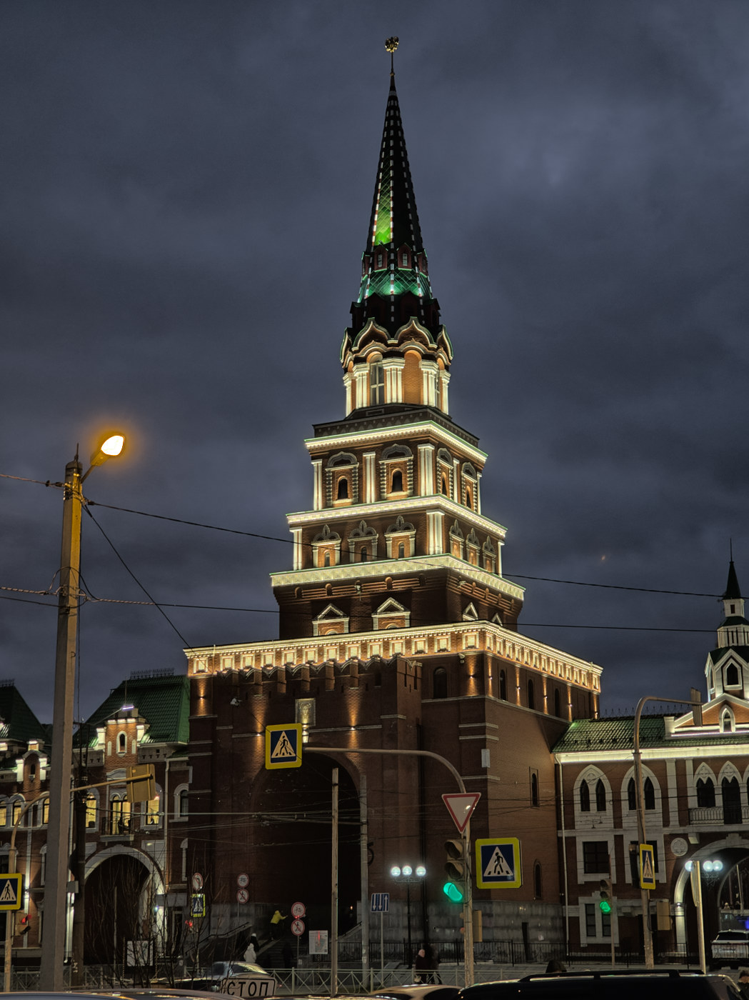
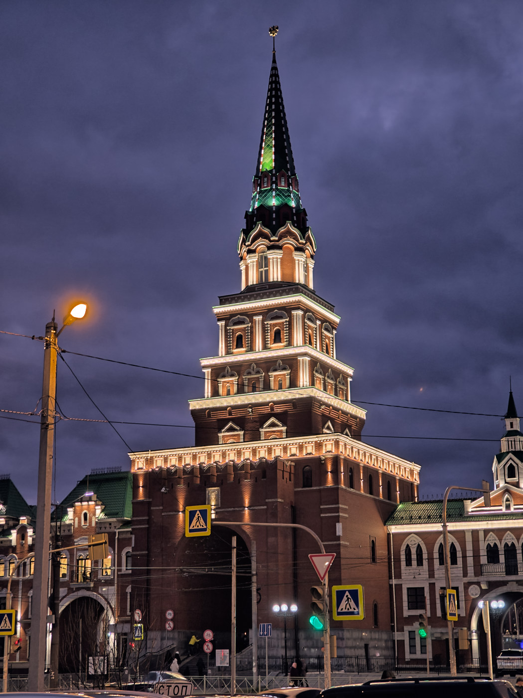
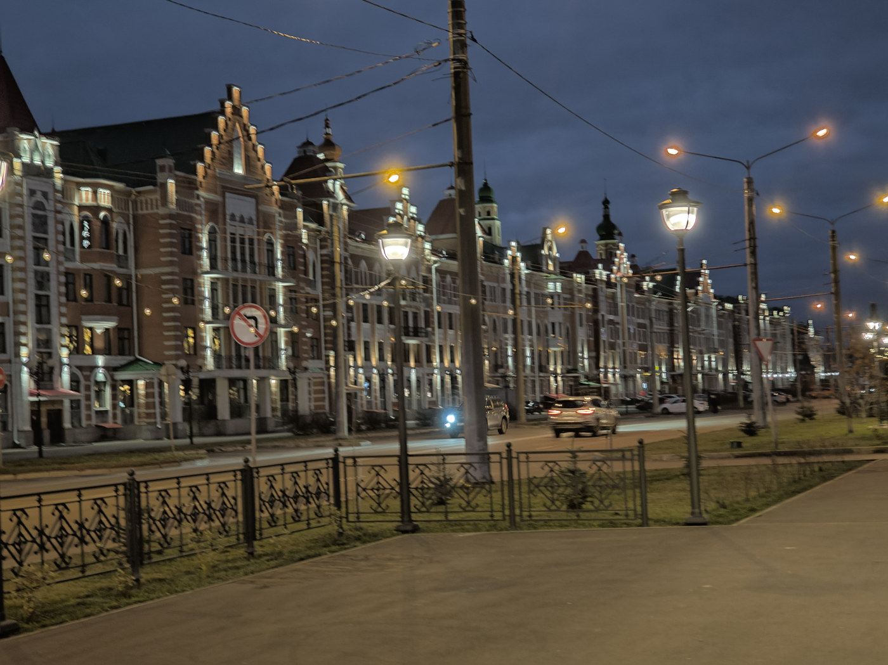
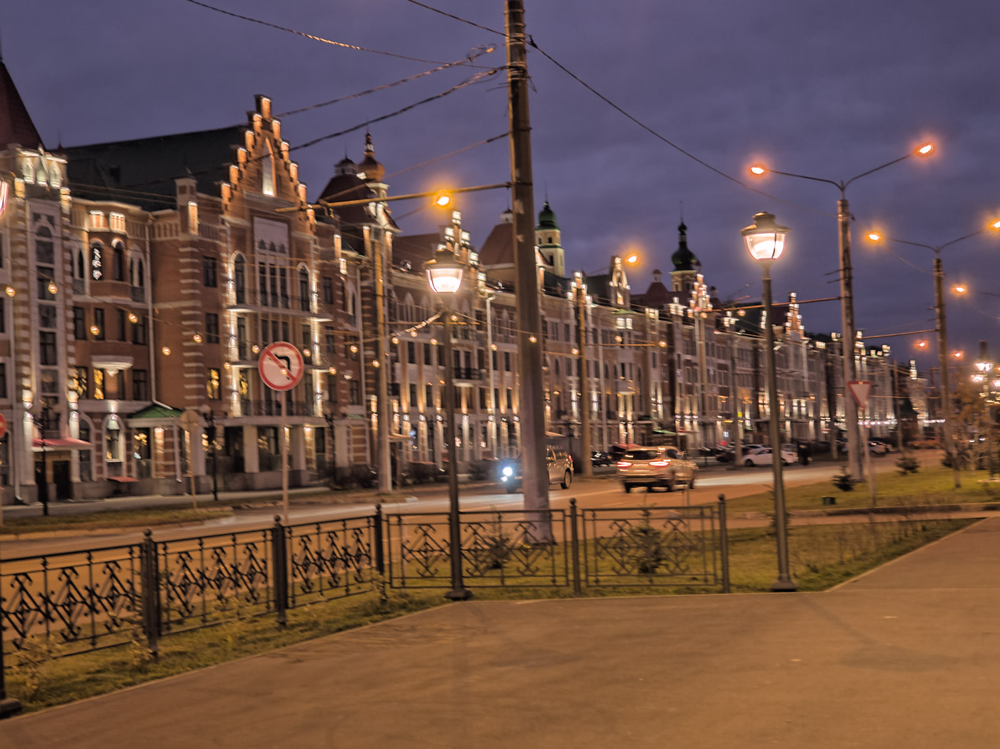
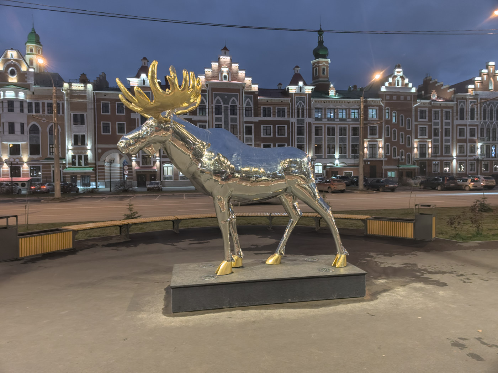
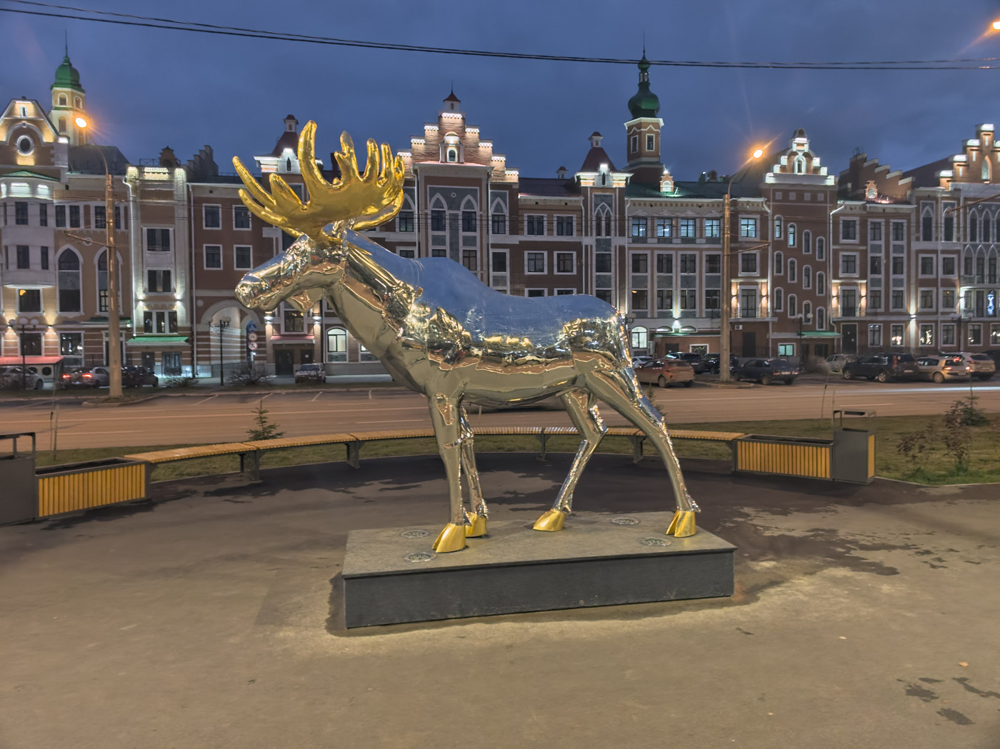
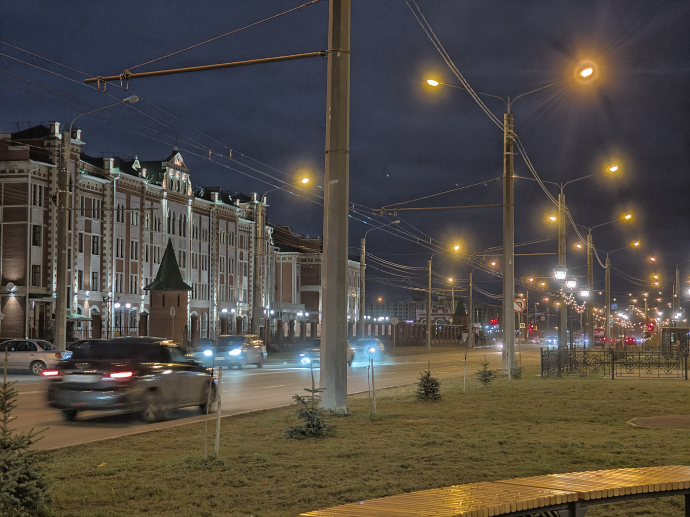
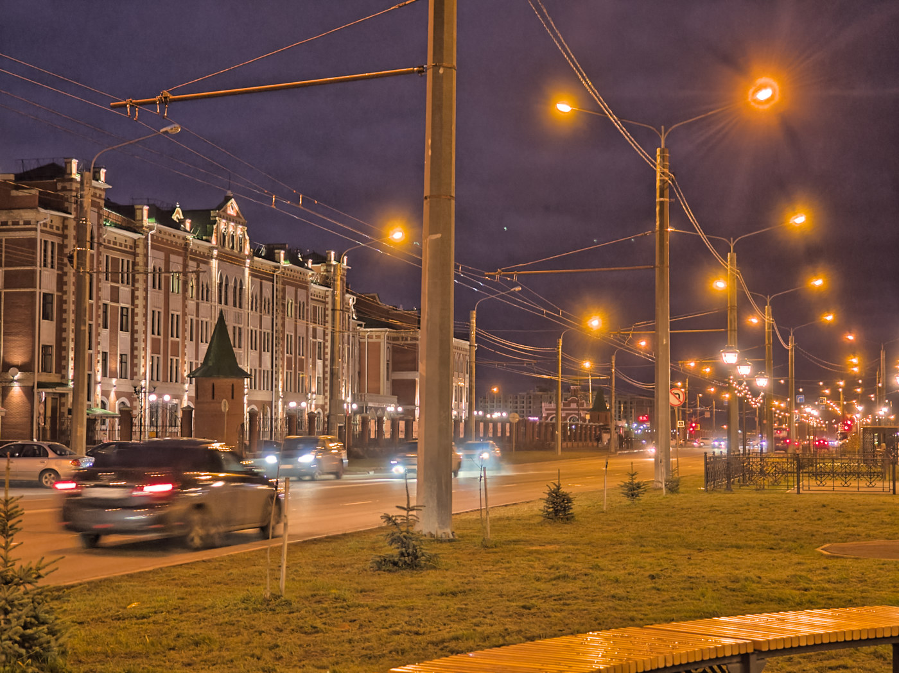
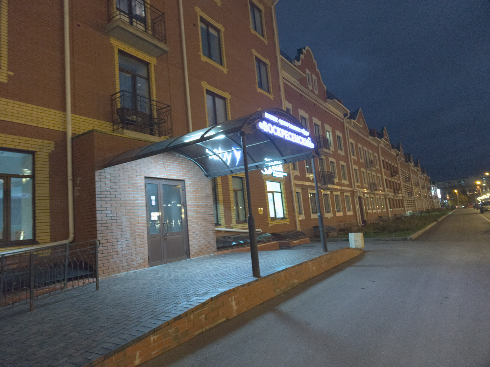
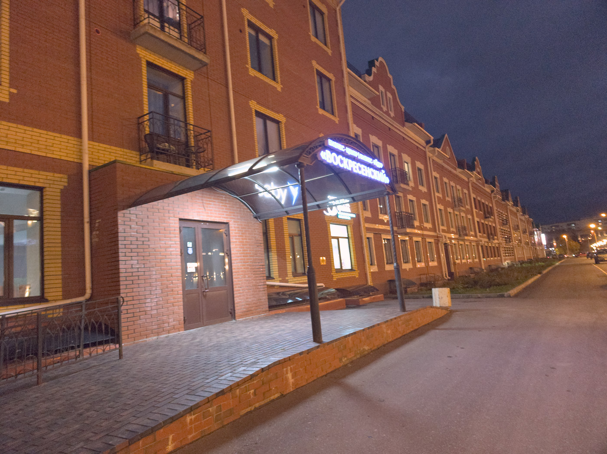

# LightCraft Manual Editing Skill

> Una skill que enseña a un agente de IA a editar fotos en **LightCraft 0.21.1** completamente **a mano**: valores explícitos de los controles, geometría real de máscaras y gestos reales del puntero. Nada de `Auto`, nada de magia.

Idiomas: [English](../README.md) · [Русский](README.ru.md) · [简体中文](README.zh-CN.md) · **Español** · [Français](README.fr.md) · [Deutsch](README.de.md) · [日本語](README.ja.md) · [Português (BR)](README.pt-BR.md) · [한국어](README.ko.md)

---

## Qué es

LightCraft es un revelador RAW de código abierto y no destructivo (alternativa a Lightroom) con servidor MCP integrado. Este repositorio es una **skill lista para usar en OpenCode / Claude Code / Codex**:

```
~/.config/opencode/skills/lightcraft/
├── SKILL.md                  # doctrina, flujo de trabajo, rutas de herramientas, trampas
├── references/               # 12 manuales bajo demanda
└── scripts/                  # lanzador MCP, lanzador de la app, actualizador, inventario de complementos
```

Cubre los **392** comandos, los **114** controles de revelado, el esquema completo de `develop`, todas las familias de máscaras, eliminación de puntos, Point Color, HDR, fusión de exposiciones, exportación y los **41 ajustes preestablecidos con sus recetas numéricas reales**.

## Instalación

```bash
git clone https://github.com/ildargiv/lightcraft-manual-skill.git \
  ~/.config/opencode/skills/lightcraft
```

Reinicia el agente para que vuelva a escanear las skills. Requisitos: LightCraft 0.21.1+ y Python 3 (solo para los scripts auxiliares).

### Conexión con la aplicación en vivo (recomendada)

El servidor MCP se registra en `opencode.json` mediante un envoltorio que se repara solo:

```json
"lightcraft": {
  "type": "local",
  "command": ["python", "<skills>/lightcraft/scripts/mcp-connect.py"],
  "enabled": true
}
```

`mcp-connect.py` inicia la aplicación de escritorio con `--control 7980` si hace falta y luego entrega stdio a `lightcraft-cli mcp --compact --connect 127.0.0.1:7980`. El agente obtiene todas las herramientas de edición **más** las de interfaz: `screenshot`, `click`, `press_key`, `pointer_gesture`, `set_ui`, `clipboard`.

Equivalente manual:

```powershell
powershell -ExecutionPolicy Bypass -File <skills>/lightcraft/scripts/start-lightcraft-app.ps1
```

## Nuestras ventajas

1. **Editar a mano es una regla, no un deseo.** Prohíbe explícitamente `develop.auto`, `develop.autoBwMix`, Auto WB, `crop.autoStraighten`, `geometry.upright auto`, `spot.findDust`/`findBlemishes`, `lensBlur.findSubject`, `preset.apply`, `develop.sync`/`autoSync` y `develop.matchExposure`. Cada prohibición incluye la alternativa manual: números y coordenadas explícitos.
2. **Cobertura total de la aplicación.** 392 comandos con parámetros, 114 controles con rangos/pasos/valores por defecto, esquema completo de `develop`, los 10 tipos de máscara, pinceles, componentes, puntos, ojos rojos, Point Color, Lens Blur, curvas, HSL, corrección de color, óptica, geometría, impresión, presentaciones y archivo.
3. **Todos los preestablecidos descompuestos en números.** Para cada uno de los 41 presets se exporta su contenido real: qué campos fija y con qué valores. El agente puede **reproducir el look a mano** y ajustarlo a cada foto en vez de pulsar un botón. Incluye además 3 preestablecidos de curva y 8 de exportación.
4. **HDR de principio a fin.** `develop.hdr` + `maxEv` + `hdr.sdr*`, fusión de exposiciones (`merge.hdr`, `hdrBatch`, panorama), exportación JPEG con gain map (ISO 21496-1), AVIF PQ/HLG de 10 bits, PNG/JXL Rec.2020 PQ de 16 bits y TIFF float de 32 bits. Verificado con ffprobe: `rgb48be`, `smpte2084`, `bt2020`. Las vistas previas siempre son SDR: el agente no «corrige» con exposición un HDR que no ve.
5. **Interfaz en vivo y gestos reales.** El modo connect ofrece `screenshot`, `click`, `pointer_gesture` y `press_key`. El agente ve el resultado en la ventana de LightCraft y puede pintar un pincel o un degradado con un gesto real en coordenadas normalizadas, no solo mediante comandos.
6. **MCP autorreparable.** El envoltorio inicia la app con el puerto de control y elimina el conflicto de `catalog.lock` (un servidor headless y la app de escritorio no pueden abrir la misma biblioteca a la vez).
7. **Documentación que se actualiza sola.** `scripts/refresh-reference.py` regenera los catálogos de comandos y controles y todas las recetas de presets desde la versión instalada, y la compara con el último lanzamiento de GitHub.
8. **Conocimiento de complementos e importación segura.** Formatos admitidos (`.lcpreset`, XMP, `.lrtemplate`, `.cube`, `.dcp`, `.lceffect`, `.lccurve`, SAM 3, denoise ONNX), flujo de importación con `dryRun`, revisión crítica de proyectos de terceros y aviso sobre paquetes piratas.
9. **Probado con RAW reales.** Los ejemplos son DNG de Xiaomi 13 Ultra editados a mano; cada uno incluye el JSON `develop` exacto para reproducirlos.
10. **Barreras de seguridad.** Experimentos solo en `photo.virtualCopy`, exportaciones de prueba a temp, negativa a sobrescribir originales/XMP, metadatos tratados como datos no fiables, `history.list`/`restore` y `edit.undo` en cada paso.

## Contenido

| Archivo | Contenido |
|---|---|
| `SKILL.md` | Doctrina manual, flujo de edición, herramientas, UI y trampas |
| `references/controls.md` | Todos los controles: id, mín, máx, valor por defecto, paso |
| `references/develop-json.md` | Esquema completo de `develop` con significado de campos |
| `references/masks-spots.md` | Formas de máscara, pinceles, componentes, puntos, ojos rojos, Point Color, Lens Blur |
| `references/hdr.md` | Edición HDR, rendición SDR, fusión, exportación, verificación |
| `references/presets.md` | 41 presets con valores exactos, curvas y presets de exportación |
| `references/manual-editing.md` | 12 recetas por género con números concretos |
| `references/export.md` | Formatos, tamaños, metadatos, marca de agua, hoja de contactos |
| `references/commands-edit.md` | Comandos de edición con todos los parámetros |
| `references/commands-rest.md` | Biblioteca, metadatos, impresión, presentaciones, rostros |
| `references/library.md` | Mapa de funciones que no son de edición |
| `references/addons.md` | Complementos, modelos y proyectos comunitarios |
| `scripts/*` | Lanzador MCP, lanzador de app, actualizador, inventario |

Seven Xiaomi 13 Ultra RAW photos from one city shoot, developed by hand. No `develop.auto`,
no `preset.apply`, no automatic straightening or subject detection. Each result comes with
its exact settings JSON so you can reproduce it with `lightcraft-cli render`.

### River HDR: headroom 3.5 EV, gradient sky mask, local tree mask


- [RAW original](../examples/01-river-hdr/original.dng) · [ajustes manuales](../examples/settings/01-river-hdr.json)

### Flower shop at blue hour: manual 4200 K balance and split grading


- [RAW original](../examples/02-blue-hour/original.dng) · [ajustes manuales](../examples/settings/02-blue-hour.json)

### Bell tower at blue hour: cool shadows, warm windows, shadow recovery





- [RAW original](../examples/03-blue-hour-tower/original.dng) · [ajustes manuales](../examples/settings/03-blue-hour-tower.json)

### Old town at dusk: 4300 K by hand, architecture and street lights





- [RAW original](../examples/04-old-town/original.dng) · [ajustes manuales](../examples/settings/04-old-town.json)

### Golden moose and city lights: controlled highlights, warm/cool grading





- [RAW original](../examples/05-golden-moose/original.dng) · [ajustes manuales](../examples/settings/05-golden-moose.json)

### Night road with bokeh: 4000 K, noise control 25/30, light trails





- [RAW original](../examples/06-night-bokeh/original.dng) · [ajustes manuales](../examples/settings/06-night-bokeh.json)

### Evening street: mixed lighting balanced manually, no Auto WB





- [RAW original](../examples/07-evening-street/original.dng) · [ajustes manuales](../examples/settings/07-evening-street.json)

All exports: `metadata=none`, 1400 px long edge, JPEG quality 88. The HDR example
additionally writes an ISO 21496-1 gain map (`hdrgm` marker verified).
## Verifícalo tú mismo

```powershell
python scripts/addon-inventory.py
python scripts/refresh-reference.py
```

```bash
lightcraft-cli render examples/01-river-hdr/original.dng -o repro.jpg \
  --settings examples/settings/01-river-hdr.json --size 1400 \
  --opt metadata=none --opt quality=88 --opt hdr=true
```

## Limitaciones

- LightCraft está en alpha (0.21.1) y todavía no tiene API de plugins oficial: los «complementos» son presets/perfiles/modelos importados y utilidades externas.
- SAM 3 no se incluye (≈3,4 GB, licencia Meta); las máscaras Object/Describe lo necesitan. Sky/Subject/Background funcionan sin él.
- LightCraft no puede mostrar HDR en pantalla: las vistas previas son SDR. Juzga el HDR por el gain map o el archivo PQ exportado.
- Los repositorios de terceros en `addons.md` son no oficiales y no verificados; revisa el código y las licencias antes de usarlos.

## Licencia

MIT — consulta [LICENSE](../LICENSE). El texto de la skill y los scripts son trabajos originales. LightCraft es un proyecto separado del equipo ArtCraft (MIT OR Apache-2.0). Los DNG de ejemplo siguen siendo propiedad de su autor y se incluyen solo como demostración.

---

Hecho para un agente que sabe pulsar botones pero prefiere trabajar con las manos.
