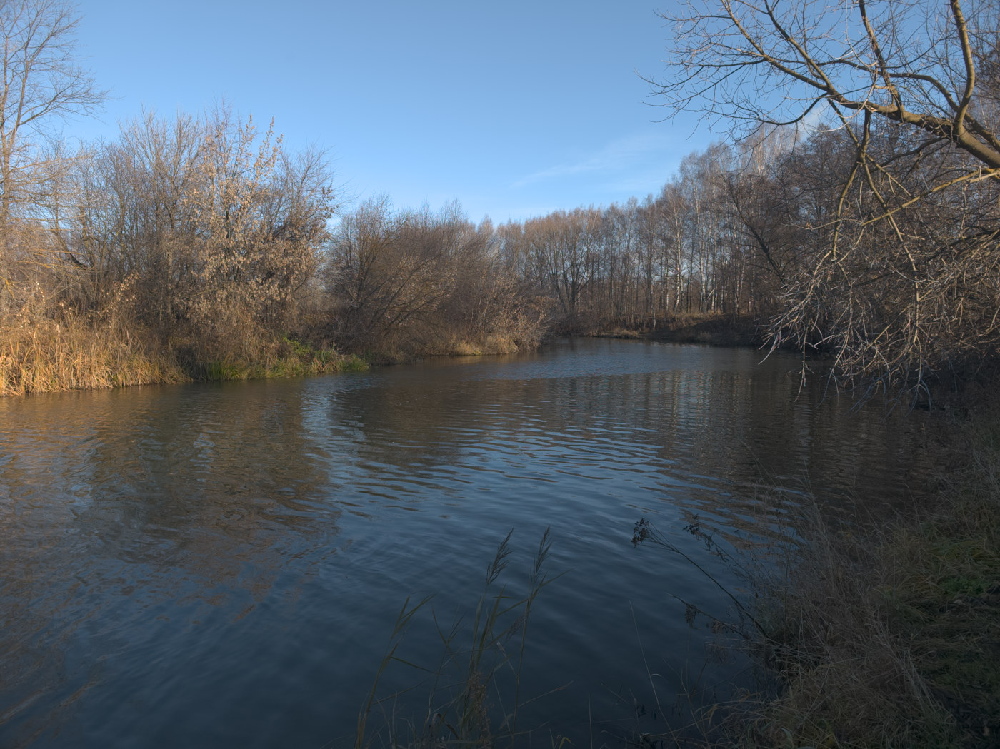

# LightCraft Manual Editing Skill

> Une skill qui apprend à un agent IA à retoucher des photos dans **LightCraft 0.21.1** entièrement **à la main** : valeurs explicites des curseurs, vraie géométrie de masques, vrais gestes du pointeur. Pas de `Auto`, pas de magie.

Langues : [English](../README.md) · [Русский](README.ru.md) · [简体中文](README.zh-CN.md) · [Español](README.es.md) · **Français** · [Deutsch](README.de.md) · [日本語](README.ja.md) · [Português (BR)](README.pt-BR.md) · [한국어](README.ko.md)

---

## Présentation

LightCraft est un développeur RAW open source et non destructif (alternative à Lightroom) avec un serveur MCP intégré. Ce dépôt est une **skill prête à l'emploi pour OpenCode / Claude Code / Codex** :

```
~/.config/opencode/skills/lightcraft/
├── SKILL.md                  # doctrine, flux de travail, routage des outils, pièges
├── references/               # 12 manuals consultables à la demande
└── scripts/                  # lanceur MCP, lanceur de l'app, rafraîchissement, inventaire des modules
```

Elle couvre les **392** commandes, les **114** curseurs de développement, le schéma complet de `develop`, toutes les familles de masques, la suppression de points, Point Color, le HDR, la fusion de bracketing, l'export et les **41 préréglages intégrés avec leurs recettes numériques réelles**.

## Installation

```bash
git clone https://github.com/ildargiv/lightcraft-manual-skill.git \
  ~/.config/opencode/skills/lightcraft
```

Redémarrez votre agent pour qu'il rescanne les skills. Prérequis : LightCraft 0.21.1+ et Python 3 (uniquement pour les scripts utilitaires).

### Connexion à l'application en direct (recommandé)

Le serveur MCP est enregistré dans `opencode.json` via un wrapper qui se répare tout seul :

```json
"lightcraft": {
  "type": "local",
  "command": ["python", "<skills>/lightcraft/scripts/mcp-connect.py"],
  "enabled": true
}
```

`mcp-connect.py` démarre l'application de bureau avec `--control 7980` si nécessaire, puis transmet stdio à `lightcraft-cli mcp --compact --connect 127.0.0.1:7980`. L'agent dispose de tous les outils d'édition **et** des outils d'interface : `screenshot`, `click`, `press_key`, `pointer_gesture`, `set_ui`, `clipboard`.

Équivalent manuel :

```powershell
powershell -ExecutionPolicy Bypass -File <skills>/lightcraft/scripts/start-lightcraft-app.ps1
```

## Nos atouts

1. **Le travail manuel est une règle, pas un souhait.** Interdit explicitement `develop.auto`, `develop.autoBwMix`, Auto WB, `crop.autoStraighten`, `geometry.upright auto`, `spot.findDust`/`findBlemishes`, `lensBlur.findSubject`, `preset.apply`, `develop.sync`/`autoSync` et `develop.matchExposure`. Chaque interdiction s'accompagne d'un remplacement manuel : nombres et coordonnées explicites.
2. **Couverture complète de l'application.** 392 commandes documentées, 114 curseurs avec plages/pas/valeurs par défaut, schéma `develop` complet, les 10 types de masques, pinceaux, composants, points, yeux rouges, Point Color, Lens Blur, courbes, HSL, étalonnage, optique, géométrie, impression, diaporama et archives.
3. **Tous les préréglages décomposés en chiffres.** Pour chacun des 41 presets intégrés, le contenu réel est exporté : quels champs sont fixés et à quelles valeurs. L'agent peut **reproduire le look à la main** et l'adapter à chaque image au lieu d'appuyer sur un bouton. S'y ajoutent 3 presets de courbe et 8 d'export.
4. **HDR de bout en bout.** `develop.hdr` + `maxEv` + `hdr.sdr*`, fusion de bracketing (`merge.hdr`, `hdrBatch`, panorama), export JPEG à gain map (ISO 21496-1), AVIF 10 bits PQ/HLG, PNG/JXL Rec.2020 PQ 16 bits et TIFF float 32 bits. Vérifié avec ffprobe : `rgb48be`, `smpte2084`, `bt2020`. Les aperçus sont toujours SDR — l'agent ne « corrige » pas un HDR invisible avec l'exposition.
5. **Interface en direct et vrais gestes.** Le mode connect fournit `screenshot`, `click`, `pointer_gesture` et `press_key`. L'agent voit le résultat dans la fenêtre LightCraft et peut tracer un pinceau ou un dégradé par un vrai geste en coordonnées normalisées, pas seulement par commandes.
6. **MCP autoréparable.** Le wrapper lance l'app avec le port de contrôle et supprime le conflit `catalog.lock` (un serveur headless et l'app de bureau ne peuvent pas ouvrir la même bibliothèque).
7. **Documentation qui se met à jour seule.** `scripts/refresh-reference.py` régénère les catalogues de commandes/curseurs et toutes les recettes de presets depuis la version installée, et la compare au dernier release GitHub.
8. **Connaissance des modules et import sûr.** Formats pris en charge (`.lcpreset`, XMP, `.lrtemplate`, `.cube`, `.dcp`, `.lceffect`, `.lccurve`, SAM 3, denoise ONNX), import avec `dryRun`, revue critique des projets tiers et mise en garde contre les paquets pirates.
9. **Validé sur de vrais RAW.** Les exemples ci-dessous sont des DNG Xiaomi 13 Ultra développés à la main ; chacun inclut le JSON `develop` exact permettant de les reproduire.
10. **Garde-fous.** Expériences uniquement sur `photo.virtualCopy`, exports de test dans temp, refus d'écraser les originaux/XMP, métadonnées traitées comme données non fiables, `history.list`/`restore` et `edit.undo` à chaque étape.

## Contenu

| Fichier | Contenu |
|---|---|
| `SKILL.md` | Doctrine manuelle, pipeline d'édition, outils, interface, pièges |
| `references/controls.md` | Tous les curseurs : id, min, max, défaut, pas |
| `references/develop-json.md` | Schéma complet de `develop` et signification des champs |
| `references/masks-spots.md` | Formes de masques, pinceaux, composants, points, yeux rouges, Point Color, Lens Blur |
| `references/hdr.md` | Édition HDR, rendu SDR, fusion, export, vérification |
| `references/presets.md` | 41 presets avec valeurs exactes, courbes, presets d'export |
| `references/manual-editing.md` | 12 recettes par genre avec des valeurs concrètes |
| `references/export.md` | Formats, tailles, métadonnées, filigrane, planche contact |
| `references/commands-edit.md` | Commandes d'édition avec tous les paramètres |
| `references/commands-rest.md` | Bibliothèque, métadonnées, impression, diaporama, visages |
| `references/library.md` | Carte des fonctions hors édition |
| `references/addons.md` | Modules, modèles et projets communautaires |
| `scripts/*` | Lanceur MCP, lanceur d'app, rafraîchissement, inventaire |

## Exemples

Trois DNG Xiaomi 13 Ultra d'une même séance (rivière près du port), développés à la main. Chaque JPEG a été produit par `lightcraft-cli render` depuis l'`original.dng` correspondant et le JSON de réglages exact — sans `develop.auto`, sans `preset.apply`, sans redressement automatique ni détection de sujet.

### 01 — Rivière HDR, dégradé de ciel et masque local sur les arbres


- [original.dng](../examples/01-river-hdr/original.dng) · [réglages manuels](../examples/settings/01-river-hdr.json) · [JPEG avec gain map HDR](../examples/01-river-hdr/after-hdr-gainmap.jpg)
- Réserve de 3,5 EV, rendu SDR réglé séparément, masque `linear` pour le ciel et `radial` pour les arbres.

### 02 — Heure bleue, WB manuel et coloration split


- [original.dng](../examples/02-blue-hour/original.dng) · [réglages manuels](../examples/settings/02-blue-hour.json)
- WB 4200 K / +6 tint à la main, ombres froides contre hautes lumières chaudes, NR 20/28.

### 03 — Heure dorée, masque chaud local




- [original.dng](../examples/03-golden-river/original.dng) · [réglages manuels](../examples/settings/03-golden-river.json)
- Hautes lumières −50, ombres +35, mélangeur orange/jaune, masque radial doux sur le feuillage.

Tous les exports utilisent `metadata=none`, 1400 px sur le grand côté et une qualité JPEG de 88. L'exemple HDR contient en plus une gain map ISO 21496-1 (marqueur `hdrgm` vérifié).

## Vérifiez par vous-même

```powershell
python scripts/addon-inventory.py
python scripts/refresh-reference.py
```

```bash
lightcraft-cli render examples/01-river-hdr/original.dng -o repro.jpg \
  --settings examples/settings/01-river-hdr.json --size 1400 \
  --opt metadata=none --opt quality=88 --opt hdr=true
```

## Limites

- LightCraft est en alpha (0.21.1) et n'a pas encore d'API de plugins officielle — les « modules » sont des presets/profils/modèles importés et des utilitaires externes.
- SAM 3 n'est pas fourni (≈3,4 Go, licence Meta) ; les masques Object/Describe en ont besoin. Sky/Subject/Background fonctionnent sans lui.
- LightCraft ne peut pas afficher le HDR à l'écran : les aperçus sont toujours SDR. Jugez le HDR d'après la gain map / le fichier PQ exporté.
- Les dépôts tiers listés dans `addons.md` sont non officiels et non vérifiés ; examinez le code et les licences avant utilisation.

## Licence

MIT — voir [LICENSE](../LICENSE). Le texte de la skill et les scripts sont des créations originales. LightCraft est un projet distinct de l'équipe ArtCraft (MIT OR Apache-2.0). Les DNG d'exemple restent la propriété de leur auteur et ne sont fournis qu'à titre de démonstration.

---

Fait pour un agent qui sait appuyer sur des boutons mais préfère travailler à la main.
