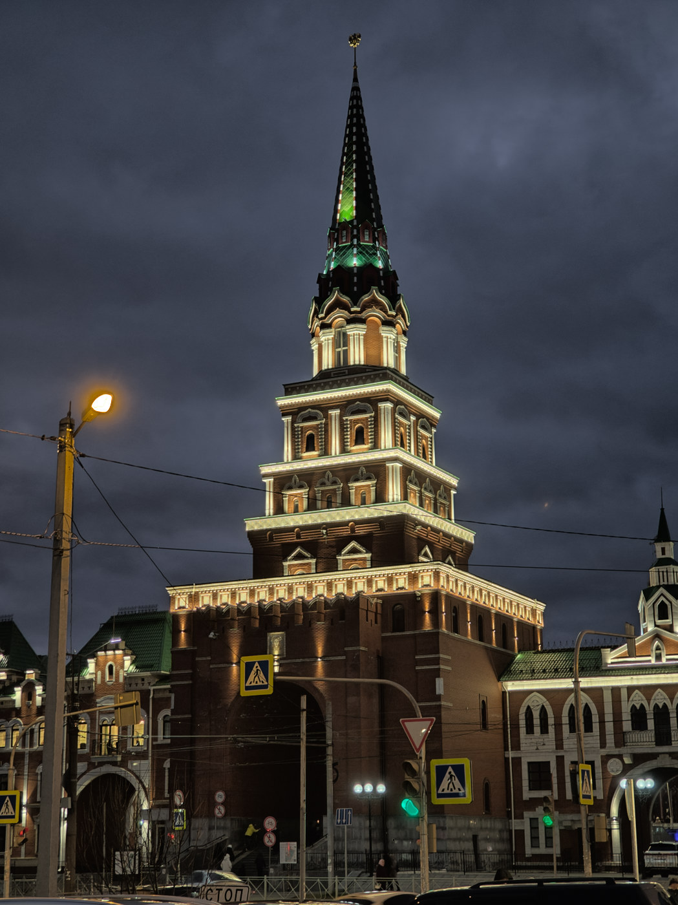
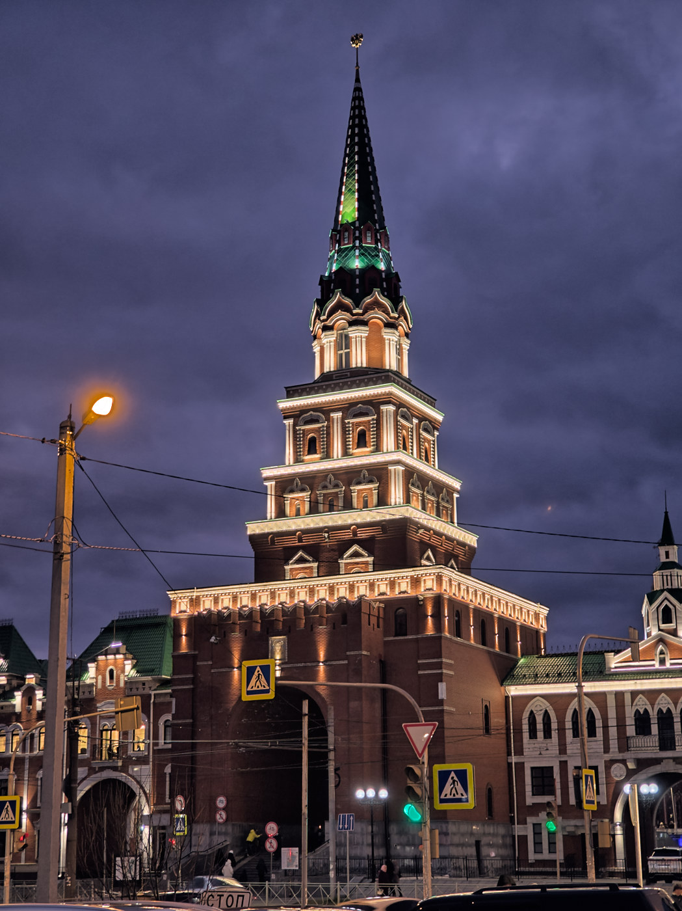
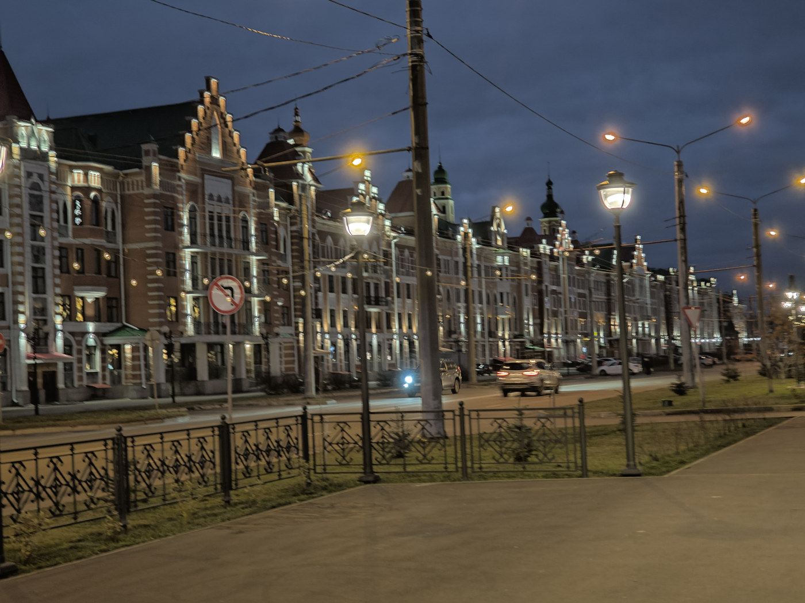
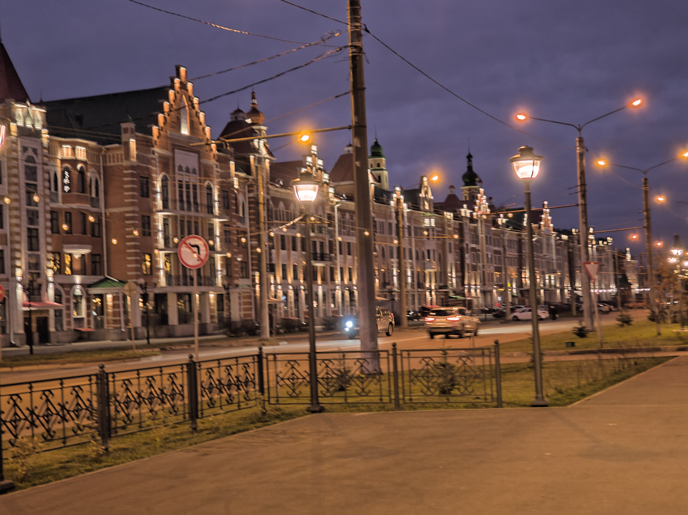
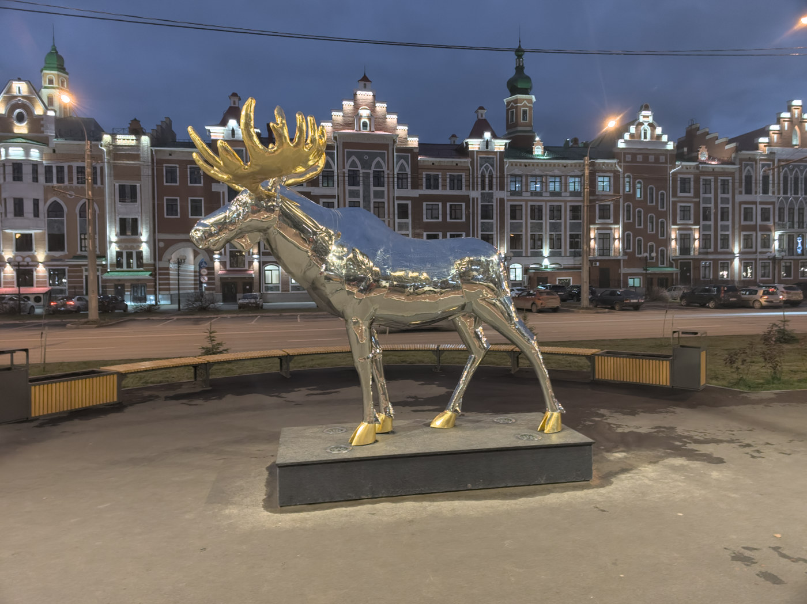
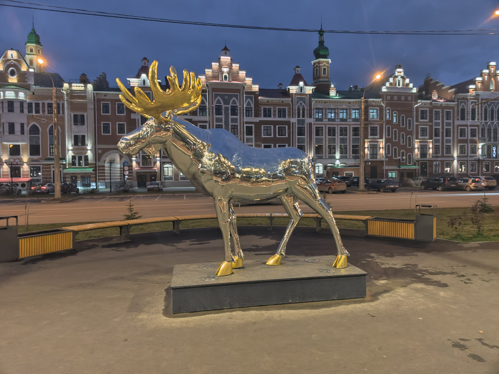
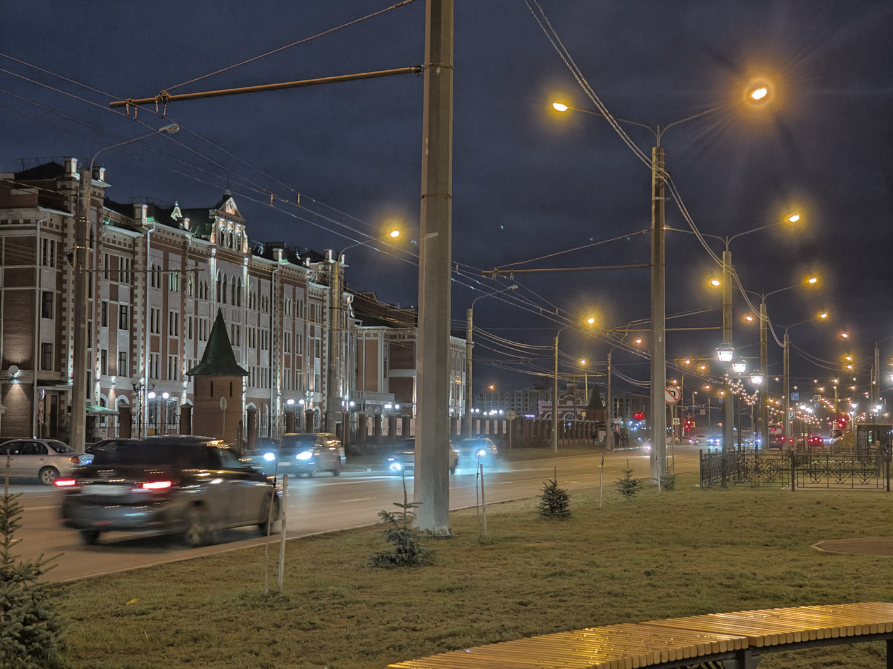
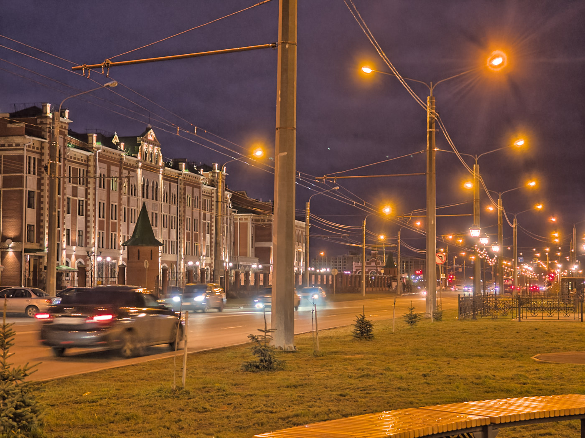
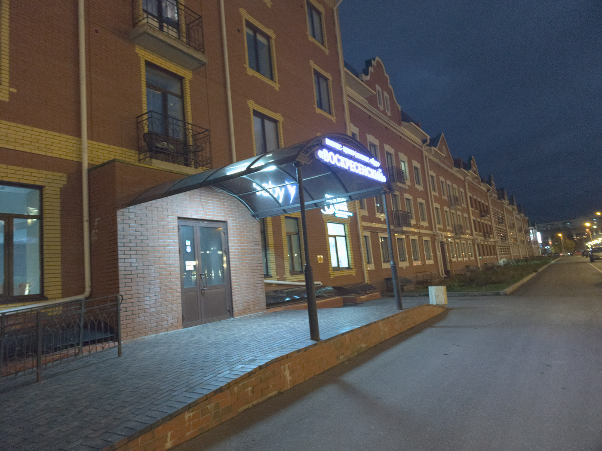
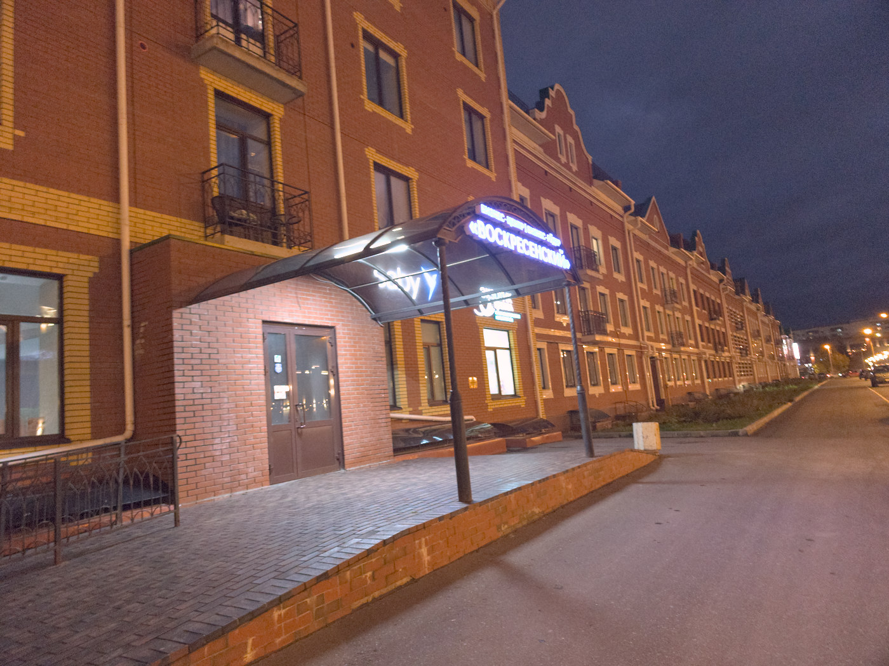

# LightCraft 手動編集スキル

> AI エージェントに **LightCraft 0.21.1** での写真編集を**すべて手動**で行わせるスキルです。明示的なスライダー値、実際のマスク形状、実際のポインタ操作。`Auto` も魔法も使いません。

言語：[English](../README.md) · [Русский](README.ru.md) · [简体中文](README.zh-CN.md) · [Español](README.es.md) · [Français](README.fr.md) · [Deutsch](README.de.md) · **日本語** · [Português (BR)](README.pt-BR.md) · [한국어](README.ko.md)

---

## 概要

LightCraft はオープンソースの非破壊 RAW 現像ソフト（Lightroom の代替）で、MCP サーバーを内蔵しています。このリポジトリは **OpenCode / Claude Code / Codex 用のすぐ使えるスキル**です。

```
~/.config/opencode/skills/lightcraft/
├── SKILL.md                  # 方針、工作流、ツールの振り分け、落とし穴
├── references/               # 必要時に読む 12 のマニュアル
└── scripts/                  # MCP 起動、アプリ起動、資料更新、アドオン一覧
```

**392** すべてのコマンド、**114** の現像スライダー、完全な `develop` JSON スキーマ、すべてのマスク種類、スポット除去、Point Color、HDR、ブラケット合成、書き出し、そして **41 の内蔵プリセットとその実際の数値レシピ**を網羅しています。

## インストール

```bash
git clone https://github.com/ildargiv/lightcraft-manual-skill.git \
  ~/.config/opencode/skills/lightcraft
```

エージェントを再起動してスキルを再スキャンしてください。要件：LightCraft 0.21.1 以降、Python 3（補助スクリプトのみ）。

### 実行中のアプリへの接続（推奨）

`opencode.json` に自己修復ラッパー経由で MCP サーバーを登録します。

```json
"lightcraft": {
  "type": "local",
  "command": ["python", "<skills>/lightcraft/scripts/mcp-connect.py"],
  "enabled": true
}
```

`mcp-connect.py` は必要なら `--control 7980` でデスクトップアプリを起動し、その後 stdio を `lightcraft-cli mcp --compact --connect 127.0.0.1:7980` に渡します。エージェントはすべての編集ツール**に加えて**ライブ UI ツール（`screenshot`、`click`、`press_key`、`pointer_gesture`、`set_ui`、`clipboard`）を取得します。

手動での同等コマンド：

```powershell
powershell -ExecutionPolicy Bypass -File <skills>/lightcraft/scripts/start-lightcraft-app.ps1
```

## 私たちの利点

1. **手動編集は願望ではなく規則。** `develop.auto`、`develop.autoBwMix`、Auto WB、`crop.autoStraighten`、`geometry.upright auto`、`spot.findDust`/`findBlemishes`、`lensBlur.findSubject`、`preset.apply`、`develop.sync`/`autoSync`、`develop.matchExposure` を明示的に禁止。禁止ごとに手動の代替（明示的な数値と座標）を提示します。
2. **アプリ全体をカバー。** 392 コマンドとパラメータ、114 スライダーの範囲/刻み/既定値、完全な `develop` スキーマ、10 種類のマスク、ブラシ、コンポーネント、スポット、赤目、Point Color、Lens Blur、カーブ、HSL、カラーグレーディング、光学、ジオメトリ、印刷、スライドショー、アーカイブ。
3. **全プリセットを数値まで分解。** 41 の内蔵プリセットそれぞれについて、実際の内容（どのフィールドをどの値に設定するか）を書き出しています。エージェントはボタンを押す代わりに**手動でルックを再現**し、写真に合わせて調整できます。ポイントカーブ 3 種、書き出しプリセット 8 種も含まれます。
4. **HDR を最初から最後まで。** `develop.hdr` + `maxEv` + `hdr.sdr*`、ブラケット合成（`merge.hdr`、`hdrBatch`、パノラマ）、ゲインマップ JPEG 書き出し（ISO 21496-1）、10bit PQ/HLG AVIF、16bit Rec.2020 PQ PNG/JXL、32bit float TIFF。ffprobe で検証済み：`rgb48be`、`smpte2084`、`bt2020`。プレビューは常に SDR なので、エージェントは見えない HDR を露光で「修正」しません。
5. **ライブ UI と本物のジェスチャ。** connect モードは `screenshot`、`click`、`pointer_gesture`、`press_key` を提供。エージェントは LightCraft のウィンドウで結果を確認でき、正規化画像座標で実際のジェスチャによりブラシやグラデーションを描けます。
6. **自己修復する MCP。** ラッパーが制御ポート付きでアプリを起動し、`catalog.lock` の競合（ヘッドレスサーバーとデスクトップアプリが同じライブラリを同時に開けない問題）を解消します。
7. **自ら更新されるドキュメント。** `scripts/refresh-reference.py` がインストール済みバージョンからコマンド/スライダー一覧と全プリセットのレシピを再生成し、GitHub の最新リリースと照合します。
8. **アドオンの知識と安全な読み込み。** 対応形式（`.lcpreset`、XMP、`.lrtemplate`、`.cube`、`.dcp`、`.lceffect`、`.lccurve`、SAM 3、denoise ONNX）、`dryRun` 読み込み、サードパーティ製プロジェクトの批判的な一覧、海賊版パッケージへの注意喚起。
9. **実際の RAW で検証。** 以下の例は Xiaomi 13 Ultra の DNG を手動で現像したもので、それぞれ再現用の正確な `develop` JSON を同梱しています。
10. **安全装置。** 実験は `photo.virtualCopy` のみ、テスト書き出しは temp、オリジナル/XMP の上書き拒否、メタデータは信頼できないデータとして扱う、各ステップで `history.list`/`restore` と `edit.undo`。

## 内容

| ファイル | 内容 |
|---|---|
| `SKILL.md` | 手動方針、編集パイプライン、ツール、UI、落とし穴 |
| `references/controls.md` | 全スライダー：id、min、max、既定値、刻み |
| `references/develop-json.md` | 完全な develop スキーマとフィールドの意味 |
| `references/masks-spots.md` | マスク形状、ブラシ、コンポーネント、スポット、赤目、Point Color、Lens Blur |
| `references/hdr.md` | HDR 編集、SDR レンディション、合成、書き出し、検証 |
| `references/presets.md` | 41 プリセットの正確な値、カーブ、書き出しプリセット |
| `references/manual-editing.md` | 12 のジャンル別レシピと具体的な数値 |
| `references/export.md` | 形式、サイズ、メタデータ、透かし、コンタクトシート |
| `references/commands-edit.md` | 編集コマンドと全パラメータ |
| `references/commands-rest.md` | ライブラリ、メタデータ、印刷、スライドショー、顔 |
| `references/library.md` | 編集以外の機能マップ |
| `references/addons.md` | アドオン、モデル、コミュニティプロジェクト |
| `scripts/*` | MCP 起動、アプリ起動、資料更新、アドオン一覧 |

Seven Xiaomi 13 Ultra RAW photos from one city shoot, developed by hand. No `develop.auto`,
no `preset.apply`, no automatic straightening or subject detection. Each result comes with
its exact settings JSON so you can reproduce it with `lightcraft-cli render`.

### River HDR: headroom 3.5 EV, gradient sky mask, local tree mask


- [元 RAW](../examples/01-river-hdr/original.dng) · [手動設定](../examples/settings/01-river-hdr.json)

### Flower shop at blue hour: manual 4200 K balance and split grading


- [元 RAW](../examples/02-blue-hour/original.dng) · [手動設定](../examples/settings/02-blue-hour.json)

### Bell tower at blue hour: cool shadows, warm windows, shadow recovery





- [元 RAW](../examples/03-blue-hour-tower/original.dng) · [手動設定](../examples/settings/03-blue-hour-tower.json)

### Old town at dusk: 4300 K by hand, architecture and street lights





- [元 RAW](../examples/04-old-town/original.dng) · [手動設定](../examples/settings/04-old-town.json)

### Golden moose and city lights: controlled highlights, warm/cool grading





- [元 RAW](../examples/05-golden-moose/original.dng) · [手動設定](../examples/settings/05-golden-moose.json)

### Night road with bokeh: 4000 K, noise control 25/30, light trails





- [元 RAW](../examples/06-night-bokeh/original.dng) · [手動設定](../examples/settings/06-night-bokeh.json)

### Evening street: mixed lighting balanced manually, no Auto WB





- [元 RAW](../examples/07-evening-street/original.dng) · [手動設定](../examples/settings/07-evening-street.json)

All exports: `metadata=none`, 1400 px long edge, JPEG quality 88. The HDR example
additionally writes an ISO 21496-1 gain map (`hdrgm` marker verified).
## 自分で確認する

```powershell
python scripts/addon-inventory.py
python scripts/refresh-reference.py
```

```bash
lightcraft-cli render examples/01-river-hdr/original.dng -o repro.jpg \
  --settings examples/settings/01-river-hdr.json --size 1400 \
  --opt metadata=none --opt quality=88 --opt hdr=true
```

## 制限

- LightCraft は alpha（0.21.1）で、公式プラグイン API はまだありません — 「アドオン」とは読み込んだプリセット/プロファイル/モデルと外部ツールのことです。
- SAM 3 は同梱されません（約 3.4 GB、Meta ライセンス）。Object/Describe マスクには必要です。Sky/Subject/Background は不要です。
- LightCraft は HDR を画面に表示できません：プレビューは常に SDR です。HDR は書き出されたゲインマップ / PQ ファイルで判断してください。
- `addons.md` のサードパーティリポジトリは非公式かつ未検証です。使用前にコードとライセンスを確認してください。

## ライセンス

MIT — [LICENSE](../LICENSE) を参照。スキル本文とスクリプトはオリジナル作品です。LightCraft 自体は ArtCraft チームの別プロジェクト（MIT OR Apache-2.0）。例の DNG は작가の所有物で、デモ目的のみに含まれます。

---

ボタンを押せるけれど、手で作業するほうが好きなエージェントのために。
