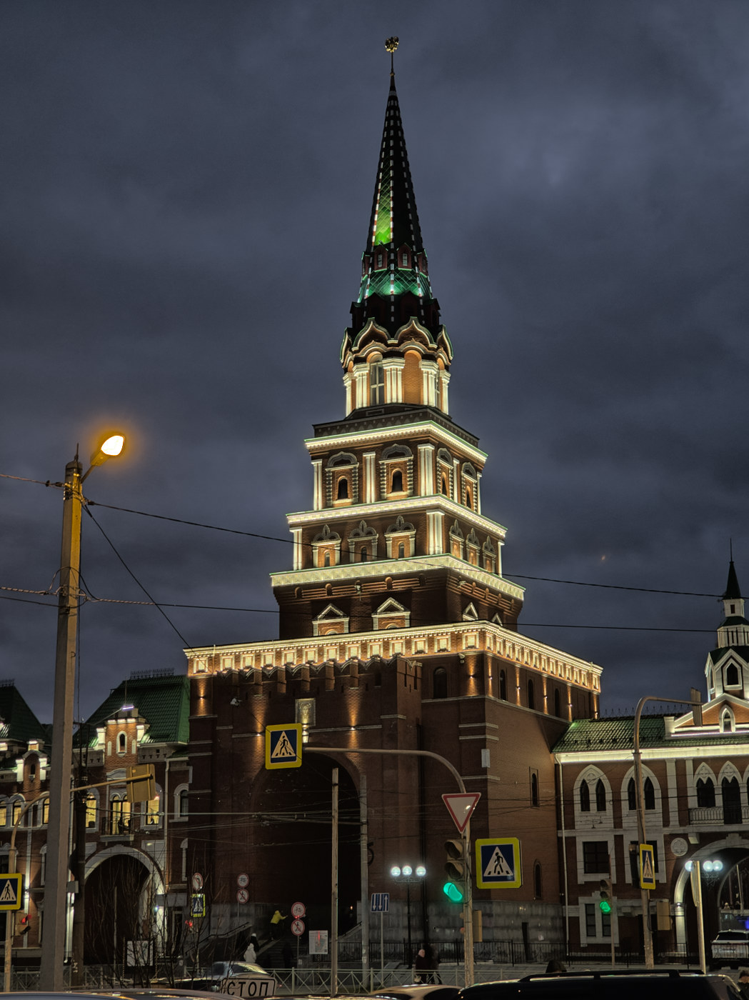
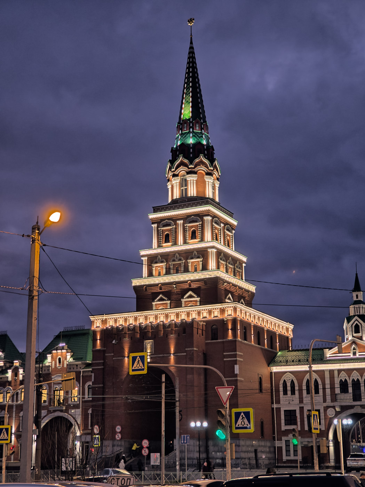
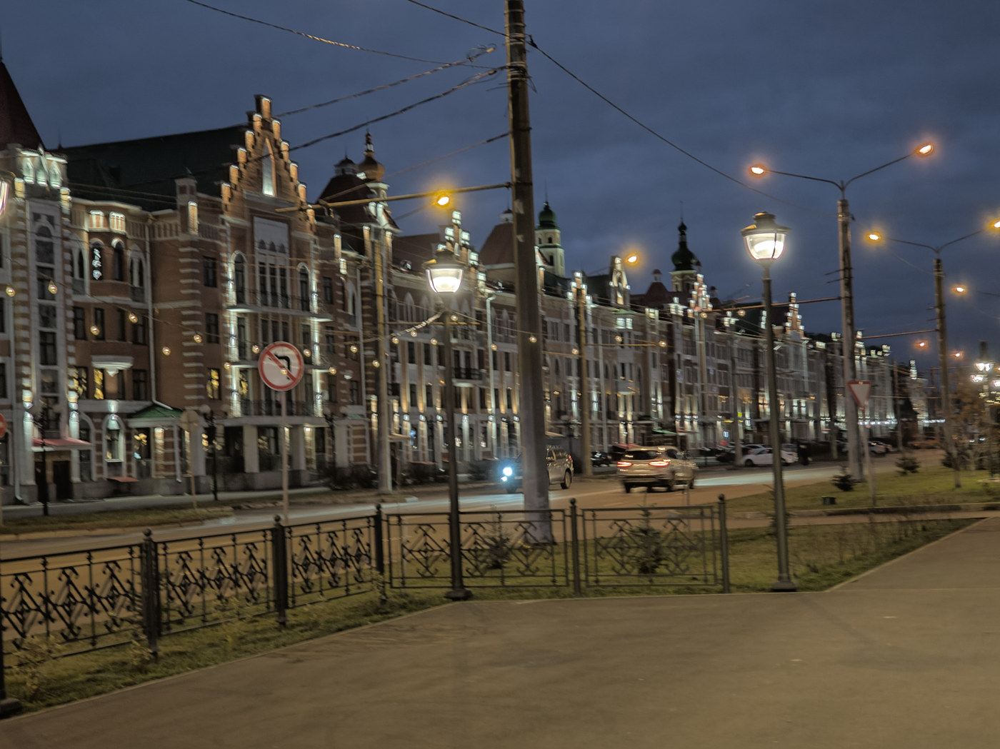
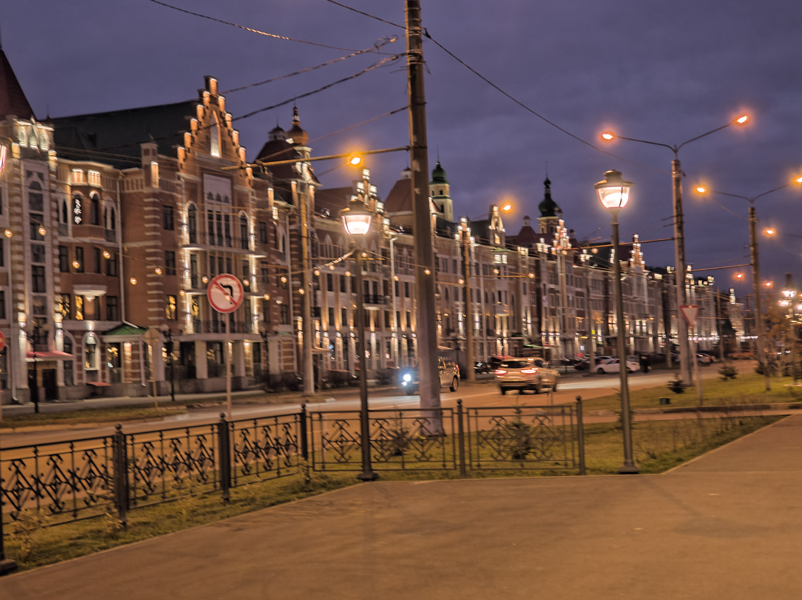
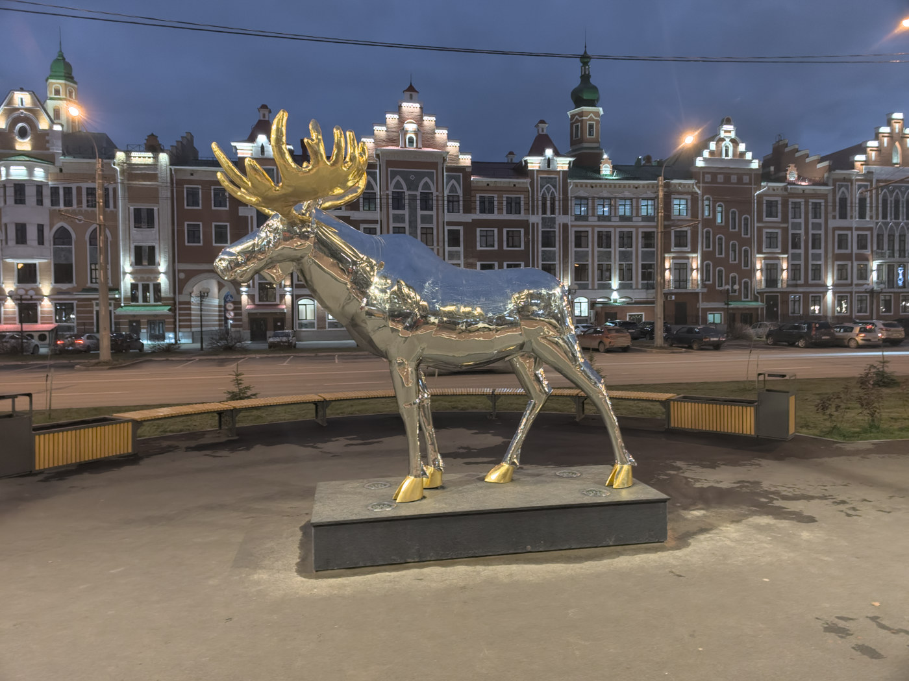
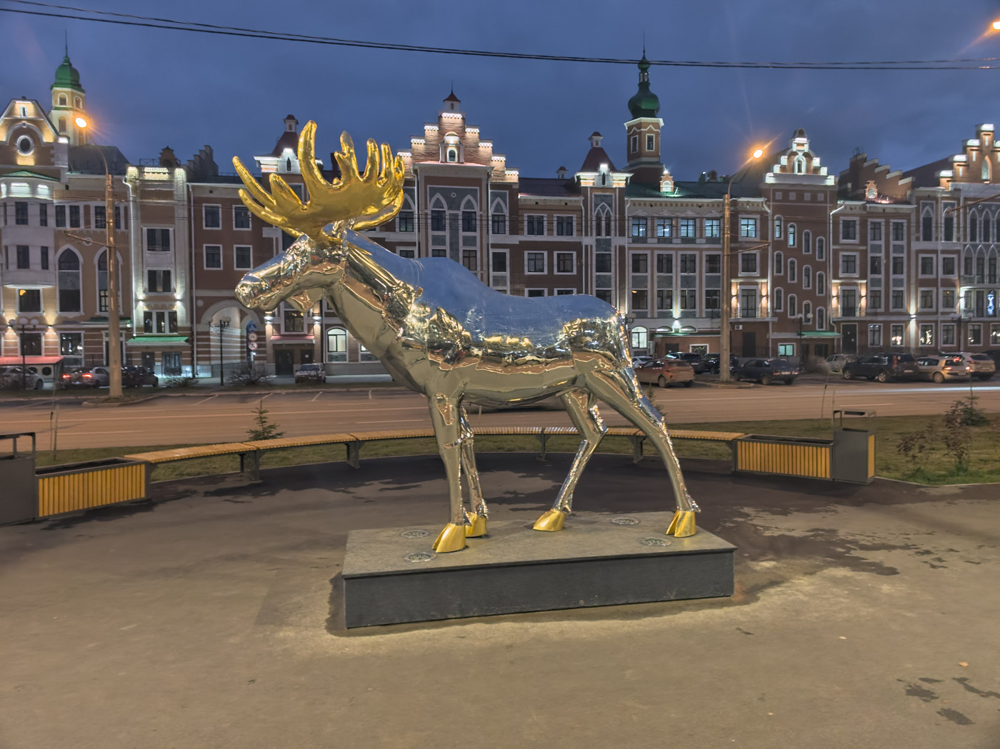
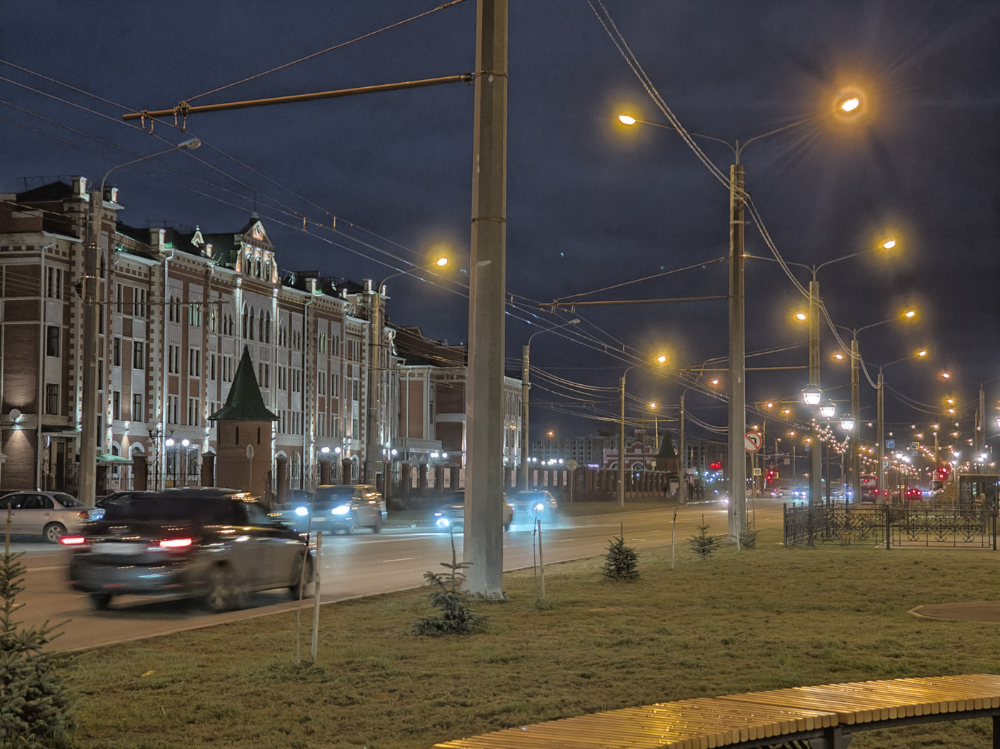
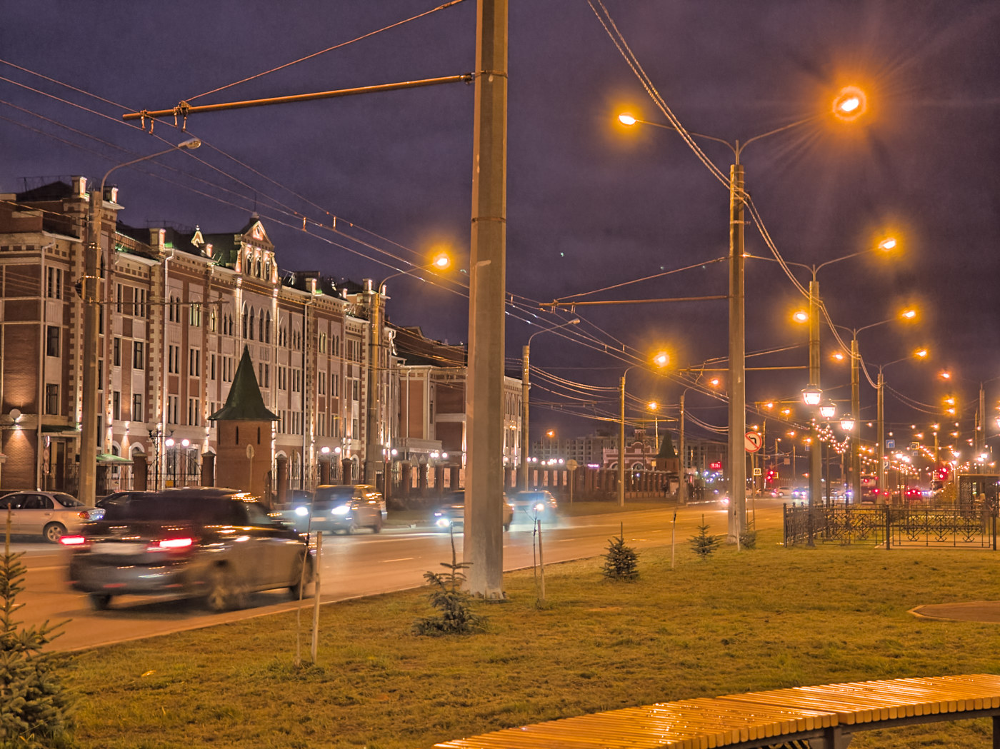
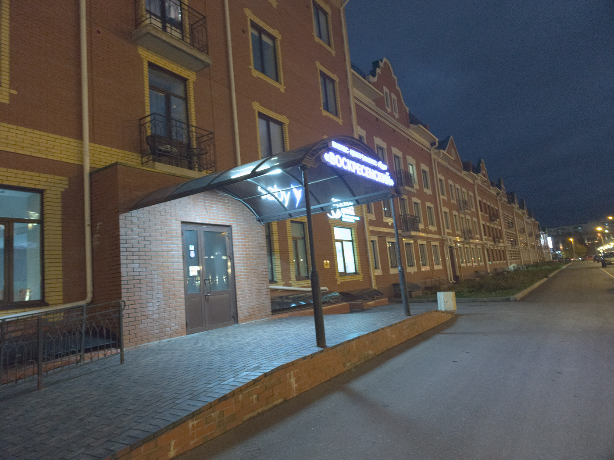
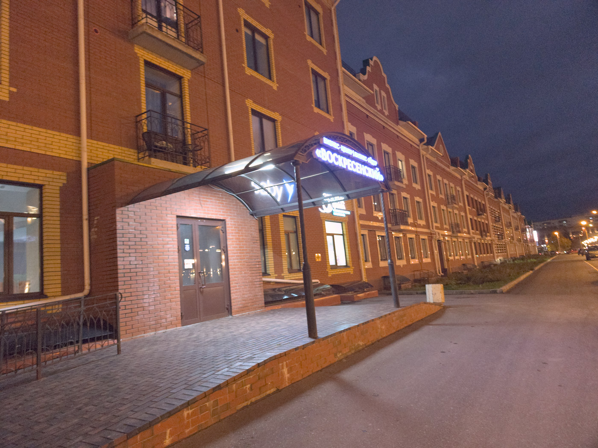

# LightCraft Manual Editing Skill

> Uma skill que ensina um agente de IA a editar fotos no **LightCraft 0.21.1** inteiramente **à mão**: valores explícitos dos controles, geometria real de máscaras e gestos reais do ponteiro. Nada de `Auto`, nada de mágica.

Idiomas: [English](../README.md) · [Русский](README.ru.md) · [简体中文](README.zh-CN.md) · [Español](README.es.md) · [Français](README.fr.md) · [Deutsch](README.de.md) · [日本語](README.ja.md) · **Português (BR)** · [한국어](README.ko.md)

---

## O que é

LightCraft é um revelador RAW de código aberto e não destrutivo (alternativa ao Lightroom) com servidor MCP integrado. Este repositório é uma **skill pronta para OpenCode / Claude Code / Codex**:

```
~/.config/opencode/skills/lightcraft/
├── SKILL.md                  # doutrina, fluxo de trabalho, rotas de ferramentas, armadilhas
├── references/               # 12 manuais sob demanda
└── scripts/                  # iniciador MCP, iniciador do app, atualização, inventário de complementos
```

Cobre os **392** comandos, os **114** controles de revelação, o esquema completo de `develop`, todas as famílias de máscaras, remoção de pontos, Point Color, HDR, fusão de exposições, exportação e os **41 presets internos com suas receitas numéricas reais**.

## Instalação

```bash
git clone https://github.com/ildargiv/lightcraft-manual-skill.git \
  ~/.config/opencode/skills/lightcraft
```

Reinicie o agente para que ele reescaneie as skills. Requisitos: LightCraft 0.21.1+ e Python 3 (apenas para os scripts auxiliares).

### Conexão com o aplicativo em execução (recomendado)

O servidor MCP é registrado no `opencode.json` por um wrapper que se autorepara:

```json
"lightcraft": {
  "type": "local",
  "command": ["python", "<skills>/lightcraft/scripts/mcp-connect.py"],
  "enabled": true
}
```

O `mcp-connect.py` inicia o aplicativo desktop com `--control 7980` se necessário e depois entrega o stdio ao `lightcraft-cli mcp --compact --connect 127.0.0.1:7980`. O agente recebe todas as ferramentas de edição **mais** as ferramentas de interface ao vivo: `screenshot`, `click`, `press_key`, `pointer_gesture`, `set_ui`, `clipboard`.

Equivalente manual:

```powershell
powershell -ExecutionPolicy Bypass -File <skills>/lightcraft/scripts/start-lightcraft-app.ps1
```

## Nossas vantagens

1. **Editar à mão é regra, não desejo.** Proíbe explicitamente `develop.auto`, `develop.autoBwMix`, Auto WB, `crop.autoStraighten`, `geometry.upright auto`, `spot.findDust`/`findBlemishes`, `lensBlur.findSubject`, `preset.apply`, `develop.sync`/`autoSync` e `develop.matchExposure`. Cada proibição vem com a substituição manual — números e coordenadas explícitos.
2. **Cobertura total do aplicativo.** 392 comandos com parâmetros, 114 controles com faixas/passos/padrões, esquema completo de `develop`, os 10 tipos de máscara, pincéis, componentes, pontos, olhos vermelhos, Point Color, Lens Blur, curvas, HSL, correção de cor, óptica, geometria, impressão, slideshow e arquivo.
3. **Todos os presets decompostos em números.** Para cada um dos 41 presets internos, o conteúdo real é exportado: quais campos ele define e com quais valores. O agente pode **reproduzir o look à mão** e adaptá-lo à foto em vez de apertar um botão. Inclui ainda 3 presets de curva de pontos e 8 de exportação.
4. **HDR de ponta a ponta.** `develop.hdr` + `maxEv` + `hdr.sdr*`, fusão de exposições (`merge.hdr`, `hdrBatch`, panorama), exportação JPEG com gain map (ISO 21496-1), AVIF PQ/HLG de 10 bits, PNG/JXL Rec.2020 PQ de 16 bits e TIFF float de 32 bits. Verificado com ffprobe: `rgb48be`, `smpte2084`, `bt2020`. As prévias são sempre SDR — o agente não “corrige” com exposição um HDR que não vê.
5. **Interface ao vivo e gestos reais.** O modo connect fornece `screenshot`, `click`, `pointer_gesture` e `press_key`. O agente vê o resultado na janela do LightCraft e pode desenhar pinceladas ou gradientes com um gesto real em coordenadas de imagem normalizadas, não apenas por comandos.
6. **MCP autorrecuperável.** O wrapper inicia o app com a porta de controle e elimina o conflito de `catalog.lock` (um servidor headless e o app desktop não podem abrir a mesma biblioteca ao mesmo tempo).
7. **Documentação que se atualiza sozinha.** `scripts/refresh-reference.py` regenera os catálogos de comandos/controles e todas as receitas de presets a partir da versão instalada e a compara com o último release do GitHub.
8. **Conhecimento de complementos e importação segura.** Formatos suportados (`.lcpreset`, XMP, `.lrtemplate`, `.cube`, `.dcp`, `.lceffect`, `.lccurve`, SAM 3, denoise ONNX), fluxo de importação com `dryRun`, revisão crítica de projetos de terceiros e aviso sobre pacotes piratas.
9. **Validado em RAW reais.** Os exemplos abaixo são DNGs Xiaomi 13 Ultra revelados à mão; cada um traz o JSON `develop` exato para reproduzi-los.
10. **Proteções.** Experimentos apenas em `photo.virtualCopy`, exportações de teste em temp, recusa em sobrescrever originais/XMP, metadados tratados como dados não confiáveis, `history.list`/`restore` e `edit.undo` em cada etapa.

## Conteúdo

| Arquivo | Conteúdo |
|---|---|
| `SKILL.md` | Doutrina manual, pipeline de edição, ferramentas, UI, armadilhas |
| `references/controls.md` | Todos os controles: id, min, max, padrão, passo |
| `references/develop-json.md` | Esquema completo de develop com significado dos campos |
| `references/masks-spots.md` | Formas de máscara, pincéis, componentes, pontos, olhos vermelhos, Point Color, Lens Blur |
| `references/hdr.md` | Edição HDR, rendição SDR, fusão, exportação, verificação |
| `references/presets.md` | 41 presets com valores exatos, curvas, presets de exportação |
| `references/manual-editing.md` | 12 receitas por gênero com números concretos |
| `references/export.md` | Formatos, tamanhos, metadados, marca d'água, folha de contato |
| `references/commands-edit.md` | Comandos de edição com todos os parâmetros |
| `references/commands-rest.md` | Biblioteca, metadados, impressão, slideshow, rostos |
| `references/library.md` | Mapa de recursos que não são de edição |
| `references/addons.md` | Complementos, modelos e projetos da comunidade |
| `scripts/*` | Iniciador MCP, iniciador do app, atualização, inventário |

Seven Xiaomi 13 Ultra RAW photos from one city shoot, developed by hand. No `develop.auto`,
no `preset.apply`, no automatic straightening or subject detection. Each result comes with
its exact settings JSON so you can reproduce it with `lightcraft-cli render`.

### River HDR: headroom 3.5 EV, gradient sky mask, local tree mask


- [RAW original](../examples/01-river-hdr/original.dng) · [ajustes manuais](../examples/settings/01-river-hdr.json)

### Flower shop at blue hour: manual 4200 K balance and split grading


- [RAW original](../examples/02-blue-hour/original.dng) · [ajustes manuais](../examples/settings/02-blue-hour.json)

### Bell tower at blue hour: cool shadows, warm windows, shadow recovery





- [RAW original](../examples/03-blue-hour-tower/original.dng) · [ajustes manuais](../examples/settings/03-blue-hour-tower.json)

### Old town at dusk: 4300 K by hand, architecture and street lights





- [RAW original](../examples/04-old-town/original.dng) · [ajustes manuais](../examples/settings/04-old-town.json)

### Golden moose and city lights: controlled highlights, warm/cool grading





- [RAW original](../examples/05-golden-moose/original.dng) · [ajustes manuais](../examples/settings/05-golden-moose.json)

### Night road with bokeh: 4000 K, noise control 25/30, light trails





- [RAW original](../examples/06-night-bokeh/original.dng) · [ajustes manuais](../examples/settings/06-night-bokeh.json)

### Evening street: mixed lighting balanced manually, no Auto WB





- [RAW original](../examples/07-evening-street/original.dng) · [ajustes manuais](../examples/settings/07-evening-street.json)

All exports: `metadata=none`, 1400 px long edge, JPEG quality 88. The HDR example
additionally writes an ISO 21496-1 gain map (`hdrgm` marker verified).
## Verifique você mesmo

```powershell
python scripts/addon-inventory.py
python scripts/refresh-reference.py
```

```bash
lightcraft-cli render examples/01-river-hdr/original.dng -o repro.jpg \
  --settings examples/settings/01-river-hdr.json --size 1400 \
  --opt metadata=none --opt quality=88 --opt hdr=true
```

## Limitações

- O LightCraft está em alpha (0.21.1) e ainda não tem API oficial de plugins — “complementos” são presets/perfis/modelos importados e utilitários externos.
- O SAM 3 não acompanha o programa (≈3,4 GB, licença Meta); máscaras Object/Describe precisam dele. Sky/Subject/Background funcionam sem ele.
- O LightCraft não consegue exibir HDR na tela: as prévias são sempre SDR. Avalie o HDR pelo gain map / arquivo PQ exportado.
- Os repositórios de terceiros em `addons.md` são não oficiais e não verificados; examine o código e as licenças antes de usar.

## Licença

MIT — veja [LICENSE](../LICENSE). O texto da skill e os scripts são trabalhos originais. O LightCraft é um projeto separado da equipe ArtCraft (MIT OR Apache-2.0). Os DNGs de exemplo continuam sendo propriedade de seu autor e foram incluídos apenas para demonstração.

---

Feito para um agente que sabe apertar botões, mas prefere trabalhar à mão.
