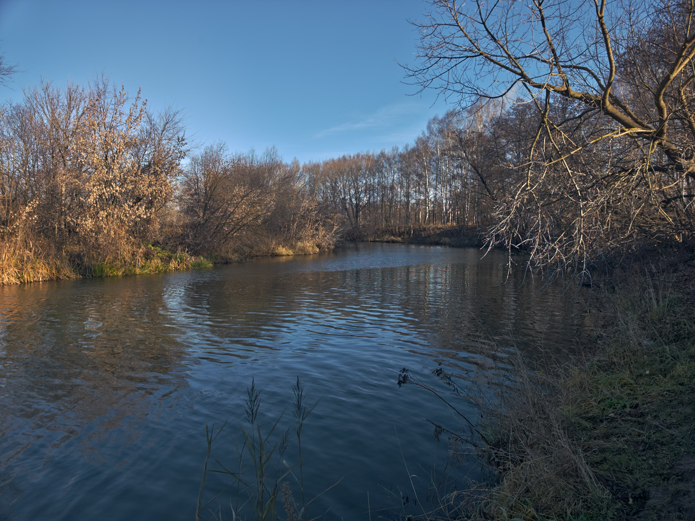

# LightCraft Manual Editing Skill

> Навык для ИИ-агента, который редактирует фото в **LightCraft 0.21.1** исключительно **руками**: явные значения слайдеров, реальная геометрия масок, настоящие жесты указателем. Никакого `Auto`, никакой магии.

Языки: [English](../README.md) · **Русский** · [简体中文](README.zh-CN.md) · [Español](README.es.md) · [Français](README.fr.md) · [Deutsch](README.de.md) · [日本語](README.ja.md) · [Português (BR)](README.pt-BR.md) · [한국어](README.ko.md)

---

## Что это

LightCraft — это открытый неразрушающий RAW-редактор (альтернатива Lightroom) со встроенным MCP-сервером. Этот репозиторий — готовый навык для **OpenCode / Claude Code / Codex**:

```
~/.config/opencode/skills/lightcraft/
├── SKILL.md                  # доктрина, рабочий процесс, маршрутизация инструментов, ловушки
├── references/               # 12 справочников, читаются по мере необходимости
└── scripts/                  # запуск MCP, запуск приложения, обновление справочников, инвентаризация дополнений
```

Он охватывает все **392** команды LightCraft, **114** слайдеров, полную схему `develop` JSON, все семейства масок, удаление точек, Point Color, HDR, склейку брекетов, экспорт и **41 встроенный пресет с их реальными числовыми рецептами**.

## Установка

```bash
git clone https://github.com/ildargiv/lightcraft-manual-skill.git \
  ~/.config/opencode/skills/lightcraft
```

Перезапустите агента, чтобы он пересканировал навыки. Требования: LightCraft 0.21.1+, Python 3 (только для вспомогательных скриптов).

### Подключение к живому приложению (рекомендуется)

MCP-сервер регистрируется в `opencode.json` через самовосстанавливающуюся обёртку:

```json
"lightcraft": {
  "type": "local",
  "command": ["python", "<skills>/lightcraft/scripts/mcp-connect.py"],
  "enabled": true
}
```

`mcp-connect.py` при необходимости запускает десктопное приложение с `--control 7980`, затем передаёт stdio в `lightcraft-cli mcp --compact --connect 127.0.0.1:7980`. Агент получает все инструменты правки **плюс** живые UI-инструменты: `screenshot`, `click`, `press_key`, `pointer_gesture`, `set_ui`, `clipboard`.

Ручной эквивалент:

```powershell
powershell -ExecutionPolicy Bypass -File <skills>/lightcraft/scripts/start-lightcraft-app.ps1
```

## Наши достоинства

1. **Ручная правка как правило, а не пожелание.** Прямой запрет на `develop.auto`, `develop.autoBwMix`, Auto WB, `crop.autoStraighten`, `geometry.upright auto`, `spot.findDust`/`findBlemishes`, `lensBlur.findSubject`, `preset.apply`, `develop.sync`/`autoSync`, `develop.matchExposure`. Для каждого запрета указана ручная замена — явные числа и координаты.
2. **Полный охват программы.** 392 команды с параметрами, 114 слайдеров с диапазонами/шагами/дефолтами, полная схема `develop` JSON, все 10 типов масок, кисти, компоненты, точки, red eye, Point Color, Lens Blur, кривые, HSL, цветокоррекция, оптика, геометрия, печать, слайдшоу, архив.
3. **Все пресеты разобраны до чисел.** Для каждого из 41 встроенного пресета выгружено фактическое содержимое: какие поля и какие значения он задаёт. Агент может **воспроизвести look руками** и довести его под кадр, а не нажимать кнопку. Плюс 3 point-curve и 8 export-пресетов.
4. **HDR от начала до конца.** `develop.hdr` + `maxEv` + `hdr.sdr*`, склейка брекетов (`merge.hdr`, `hdrBatch`, панорама), экспорт gain-map JPEG (ISO 21496-1), 10-bit PQ/HLG AVIF, 16-bit Rec.2020 PQ PNG/JXL, 32-bit float TIFF. Проверено через ffprobe: `rgb48be`, `smpte2084`, `bt2020`. Превью всегда SDR — агент не «исправляет» невидимый HDR экспозицией.
5. **Живой UI и настоящие жесты.** Connect-режим даёт `screenshot`, `click`, `pointer_gesture`, `press_key`. Агент видит результат в окне LightCraft и может провести кисть или градиент реальным жестом в нормализованных координатах кадра, а не только командами.
6. **Самовосстанавливающийся MCP.** Обёртка поднимает приложение с контрольным портом и убирает конфликт `catalog.lock` (headless-сервер и десктоп не могут держать одну библиотеку одновременно).
7. **Самообновляемая документация.** `scripts/refresh-reference.py` перегенерирует каталоги команд и слайдеров и рецепты всех пресетов из установленной версии и сверяет её с последним релизом GitHub.
8. **Знание дополнений и безопасный импорт.** Поддерживаемые форматы (`.lcpreset`, XMP, `.lrtemplate`, `.cube`, `.dcp`, `.lceffect`, `.lccurve`, SAM 3, denoise ONNX), импорт с `dryRun`, критический обзор сторонних проектов и предупреждение о пиратских сборках.
9. **Проверено на реальных RAW.** Примеры ниже — Xiaomi 13 Ultra DNG, обработаны вручную; к каждому приложен точный `develop` JSON для воспроизведения.
10. **Предохранители.** Эксперименты только на `photo.virtualCopy`, тестовые экспорты в temp, отказ перезаписывать оригиналы/XMP, работа с метаданными как с недоверенными данными, `history.list`/`restore` и `edit.undo` на каждом шаге.

## Содержание

| Файл | Что внутри |
|---|---|
| `SKILL.md` | Доктрина ручной правки, конвейер, маршрутизация инструментов, UI, ловушки |
| `references/controls.md` | Все слайдеры: id, min, max, дефолт, шаг |
| `references/develop-json.md` | Полная схема настроек develop с смыслом полей |
| `references/masks-spots.md` | Все формы масок, кисти, компоненты, точки, red eye, Point Color, Lens Blur |
| `references/hdr.md` | HDR-правка, SDR-рендишн, склейка, экспорт, проверка |
| `references/presets.md` | 41 пресет с точными значениями, кривые, export-пресеты |
| `references/manual-editing.md` | 12 рецептов по жанрам с конкретными числами |
| `references/export.md` | Форматы, размеры, метаданные, watermark, контактный лист |
| `references/commands-edit.md` | Команды редактирования с полными параметрами |
| `references/commands-rest.md` | Библиотека, метаданные, печать, слайдшоу, лица |
| `references/library.md` | Карта не-редакторских возможностей |
| `references/addons.md` | Дополнения, модели, сторонние проекты |
| `scripts/*` | Запуск MCP, запуск приложения, обновление справочников, инвентаризация |

## Примеры

Три DNG Xiaomi 13 Ultra с одной съёмки (речка у порта), обработаны вручную. Каждый JPEG получен через `lightcraft-cli render` из соответствующего `original.dng` с точным JSON настроек — без `develop.auto`, без `preset.apply`, без авто-выравнивания и распознавания объектов.

### 01 — HDR-речка, градиент неба и локальная маска деревьев




- [original.dng](../examples/01-river-hdr/original.dng) · [настройки](../examples/settings/01-river-hdr.json) · [HDR gain-map JPEG](../examples/01-river-hdr/after-hdr-gainmap.jpg)
- Запас 3.5 EV, SDR-рендишн настроен отдельно, маски `linear` (небо) и `radial` (деревья).

### 02 — Синий час, ручной WB и split-grading


- [original.dng](../examples/02-blue-hour/original.dng) · [настройки](../examples/settings/02-blue-hour.json)
- WB 4200 K / +6 tint вручную, холодные тени против тёплых бликов, NR 20/28.

### 03 — Золотой час, тёплая локальная маска


- [original.dng](../examples/03-golden-river/original.dng) · [настройки](../examples/settings/03-golden-river.json)
- Блики −50, тени +35, оранжево-жёлтый HSL, мягкая радиальная маска листвы.

Все экспорты: `metadata=none`, длинная сторона 1400 px, JPEG quality 88. HDR-пример дополнительно содержит ISO 21496-1 gain map (маркер `hdrgm` проверен).

## Проверьте сами

```powershell
python scripts/addon-inventory.py
python scripts/refresh-reference.py
```

```bash
lightcraft-cli render examples/01-river-hdr/original.dng -o repro.jpg \
  --settings examples/settings/01-river-hdr.json --size 1400 \
  --opt metadata=none --opt quality=88 --opt hdr=true
```

## Ограничения

- LightCraft находится в стадии alpha (0.21.1); официального plugin API пока нет — «дополнения» это импортируемые пресеты/профили/модели и внешние утилиты.
- SAM 3 не входит в поставку (≈3.4 ГБ, лицензия Meta); для масок Object/Describe он нужен. Sky/Subject/Background работают без него.
- LightCraft не умеет показывать HDR на экране: превью всегда SDR. О HDR судить по экспортированному gain map / PQ-файлу.
- Сторонние репозитории из `addons.md` неофициальны и не проверены; изучайте код и лицензии перед использованием.

## Лицензия

MIT — см. [LICENSE](../LICENSE). Текст навыка и скрипты — оригинальные работы. Сам LightCraft — отдельный проект команды ArtCraft (MIT OR Apache-2.0). Примеры DNG остаются собственностью автора и приведены только для демонстрации.

---

Сделано для агента, который умеет нажимать кнопки, но предпочитает работать руками.
